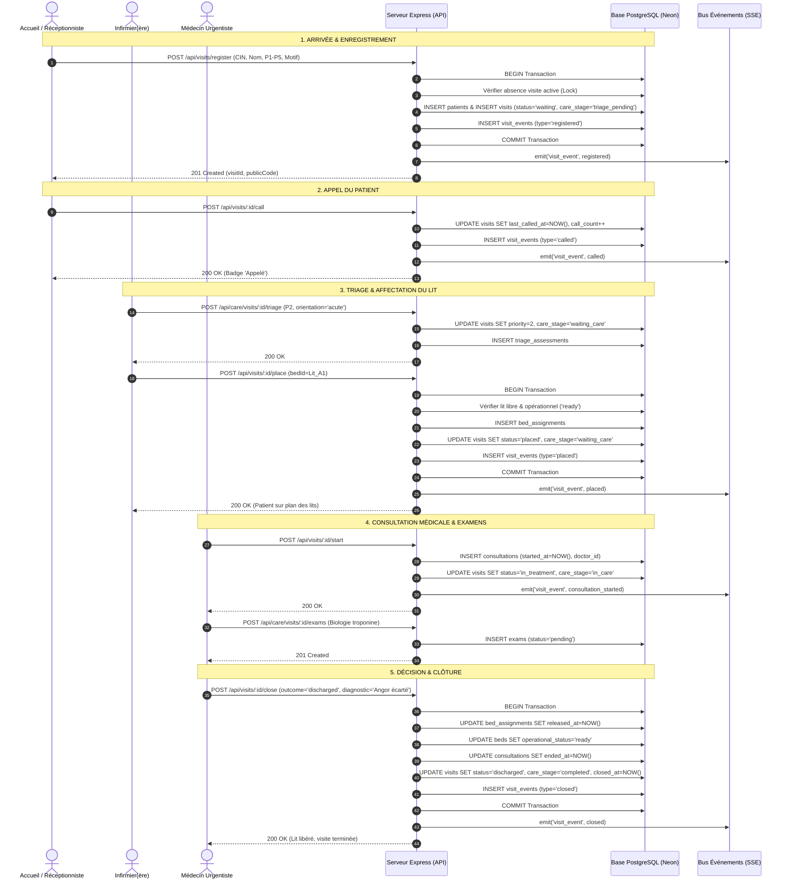
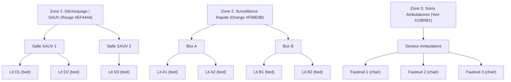
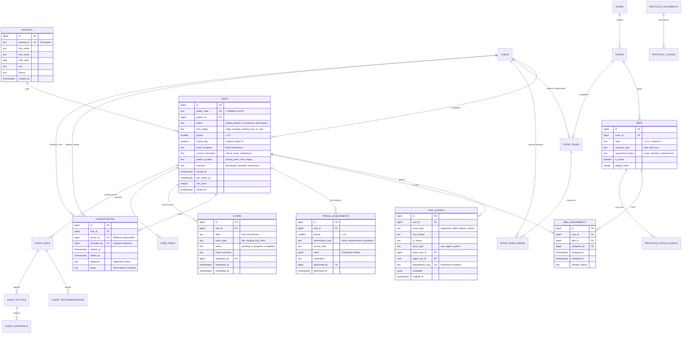
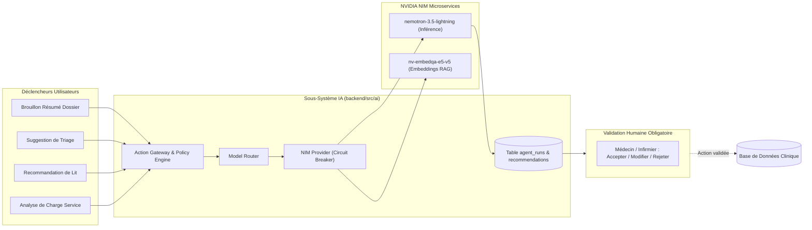

# ANALYSE ARCHITECTURALE ET FONCTIONNELLE COMPLÈTE — PLATEFORME DE GESTION DU SERVICE DES URGENCES DU CHU DE FÈS (PICU / SMART EMERGENCY FLOW)

> **Document de Référence pour l'Ingénierie Logicielle, le Rapport de Stage Académique et la Soutenance Professionnelle**  
> **Contexte Institutionnel :** Direction Générale du CHU Hassan II de Fès (Maroc) — Département Informatique  
> **Plateforme :** PICU (*Plateforme Intelligente de Coordination des Urgences* / *Smart Emergency Flow V3*)  
> **Auteur du projet (dépôt) :** Younes Basir (Étudiant-Ingénieur / Stagiaire)  
> **Date d'exploration et de validation du code :** Octobre 2026  
> **Statut de validation :** Exploration exhaustive et audit de code source (Backend Node.js/Express, Frontend React 19/Vite, Base PostgreSQL Neon, Moteur IA NVIDIA NIM / Hybride).

---

## TABLE DES MATIÈRES

1. [PARTIE 1 — Vue d'Ensemble Exécutive du Projet](#partie-1--vue-densemble-exécutive-du-projet)
2. [PARTIE 2 — Pile Technologique Complète et Justifiée](#partie-2--pile-technologique-complète-et-justifiée)
3. [PARTIE 3 — Architecture du Dépôt et des Applications](#partie-3--architecture-du-dépôt-et-des-applications)
4. [PARTIE 4 — Inventaire Fonctionnel Exhaustif des Modules](#partie-4--inventaire-fonctionnel-exhaustif-des-modules)
5. [PARTIE 5 — Rôles Utilisateurs, Habilitations et Matrice RBAC](#partie-5--rôles-utilisateurs-habilitations-et-matrice-rbac)
6. [PARTIE 6 — Parcours Patient Intégral (*Patient Journey*)](#partie-6--parcours-patient-intégral-patient-journey)
7. [PARTIE 7 — Moteur de File d'Attente et Algorithme de Priorisation](#partie-7--moteur-de-file-dattente-et-algorithme-de-priorisation)
8. [PARTIE 8 — Gestion des Salles, Lits et Ressources Matérielles](#partie-8--gestion-des-salles-lits-et-ressources-matérielles)
9. [PARTIE 9 — Modèle de Données et Schéma PostgreSQL Exhaustif](#partie-9--modèle-de-données-et-schéma-postgresql-exhaustif)
10. [PARTIE 10 — Catalogue des APIs et Logique Métier Backend](#partie-10--catalogue-des-apis-et-logique-métier-backend)
11. [PARTIE 11 — Frontend, Expérience Utilisateur (UX) et Ergonomie Hospitalière](#partie-11--frontend-expérience-utilisateur-ux-et-ergonomie-hospitalière)
12. [PARTIE 12 — Sécurité, Confidentialité des Données et Sécurité Clinique](#partie-12--sécurité-confidentialité-des-données-et-sécurité-clinique)
13. [PARTIE 13 — Tests, Performance, Déploiement et Exploitation](#partie-13--tests-performance-déploiement-et-exploitation)
14. [PARTIE 14 — Évaluation Globale et Feuille de Route Priorisée (P0 à P3)](#partie-14--évaluation-globale-et-feuille-de-route-priorisée-p0-à-p3)
15. [PARTIE 15 — Préparation et Intégration de l'Intelligence Artificielle (NVIDIA NIM)](#partie-15--préparation-et-intégration-de-lintelligence-artificielle-nvidia-nim)
16. [PARTIE 16 — Support Académique : Rédaction du Rapport de Stage](#partie-16--support-académique--rédaction-du-rapport-de-stage)
17. [PARTIE 17 — Guide de Soutenance et Scénario de Démonstration en Direct](#partie-17--guide-de-soutenance-et-scénario-de-démonstration-en-direct)
18. [PARTIE 18 — Index d'Éléments de Preuve et Traçabilité du Code Source](#partie-18--index-déléments-de-preuve-et-traçabilité-du-code-source)
19. [PARTIE 19 — Questions Ouvertes pour le Contexte Réel du CHU de Fès](#partie-19--questions-ouvertes-pour-le-contexte-réel-du-chu-de-fès)
20. [PARTIE 20 — Synthèse de Passation pour Assistant IA (*AI Handoff Summary*)](#partie-20--synthèse-de-passation-pour-assistant-ia-ai-handoff-summary)

---

# PARTIE 1 — VUE D'ENSEMBLE EXÉCUTIVE DU PROJET

### 1.1 Titre et Finalité du Projet
* **Titre Officiel :** PICU — Plateforme Intelligente de Coordination des Urgences (*Smart Emergency Flow*).
* **Finalité :** Digitaliser, sécuriser et fluidifier la chaîne de prise en charge des patients admis aux urgences du Centre Hospitalier Universitaire (CHU) Hassan II de Fès, depuis leur enregistrement initial jusqu’à leur orientation, installation sur lit/box, consultation médicale, prescription d'examens complémentaires et clôture de visite (sortie, hospitalisation ou transfert).

### 1.2 Contexte Institutionnel et de Stage
Le projet s'inscrit dans le cadre du stage technique / projet de fin d'études réalisé au sein du **Département Informatique de la Direction Générale du CHU de Fès (Maroc)**. Le CHU Hassan II est une structure hospitalière tertiaire de référence pour la région Fès-Meknès, accueillant un flux massif et continu de patients présentant des niveaux d'acuité médicale extrêmement hétérogènes (de la détresse vitale immédiate aux soins ambulatoires non programmés).

### 1.3 Problématique Métier et Défis Opérationnels
Dans un service d'urgence surchargé, plusieurs dysfonctionnements majeurs surviennent sans outil de coordination en temps réel :
1. **Perte de traçabilité et opacité des délais :** Le suivi sur registre papier ou tableur non synchronisé empêche de savoir exactement où se trouve un patient, combien de temps il a attendu, ou s'il a déjà été appelé.
2. **Risque d'engorgement et de saturation non anticipée :** L'absence d'indicateurs synthétiques instantanés sur la disponibilité des lits et la charge des salles (Déchoquage/SAUV, Surveillance Rapide, Ambulatoire) entraîne des retards dans l'accueil des cas critiques.
3. **Erreurs de priorisation et rupture de chaîne :** Risque de retard dans la réévaluation des patients en salle d'attente dont l'état clinique s'aggrave insidieusement.
4. **Désalignement d'équipe :** Asynchronie entre le personnel d'accueil (qui enregistre et appelle), les infirmiers (qui trient et installent les patients sur les lits de leurs secteurs) et les médecins (qui mènent l'examen clinique et actent la décision médicale).

### 1.4 Objectifs Assignés au Système
* Fournir une **source unique de vérité** (*Single Source of Truth*) pour l'état d'une visite d'urgence (`visits.status` et `visits.care_stage`).
* Assurer une **file d'attente calculée mathématiquement et dynamiquement**, éliminant tout conflit de position physique stockée ou tout risque de double attribution de rang.
* Visualiser en temps réel le **plan d'occupation des lits et des boxes** par zone hospitalière.
* Permettre une **gouvernance d'équipe par salle** (*room teams*) rattachant un médecin responsable et des infirmiers dédiés à chaque salle de soins.
* Fournir une **piste d'audit immuable** (`visit_events`) traçant chaque transition, acteur, horodatage et justification clinique.
* Préparer une couche d'assistance intelligente (NVIDIA NIM) modulaire et sécurisée, sans jamais que le modèle de langage (LLM) ne devienne une source de vérité ou ne contourne la validation humaine.

### 1.5 Acteurs et Services Cibles
* **Agents d'Accueil / Réceptionnistes :** Enregistrement des données administratives, vérification d'identité (CIN), premier recueil du motif d'urgence, appel nominatif des patients.
* **Infirmiers (IOA & Soins) :** Validation et réévaluation du triage (priorités P1 à P5), orientation vers les secteurs de soins, affectation et libération des lits/fauteuils, saisie d'actes et de notes au nom de l'équipe de salle.
* **Médecins Urgentistes :** Prise en charge clinique, ouverture formelle de la consultation, prescription et validation d'examens (biologie, imagerie, ECG), diagnostic et décision médicale de sortie/hospitalisation/transfert.
* **Chef de Service des Urgences :** Pilotage global, surveillance des délais d'attente et des alertes de dépassement SLA, constitution des équipes médicales par salle, arbitrage en cas de saturation de capacité, supervision des modes IA.
* **Administrateurs Informatiques :** Gestion des utilisateurs, provisionnement des comptes via jetons temporaires sécurisés, maintenance et réinitialisation maîtrisée des environnements de démonstration.

### 1.6 Solution Réalisée et Fonctionnalités Clés
Le projet a été développé en deux phases évolutives visibles dans le dépôt :
* **Socle V1/Phase A (Solide & Transactionnel) :** Modèle d'actions strictes piloté par transactions PostgreSQL et machine à états (`register` → `call` → `place` → `start` → `fill` → `close` / `return`).
* **Extension V3 / Smart Emergency Flow (Multi-dimensionnelle) :** Découplage de la priorité clinique (`priority`), de l'étape de soins (`care_stage`), de la localisation physique (`patient_location`) et de la ressource (`bed_id`), avec intégration de worklists calculées (`queueService.js`), gestion des examens (`exams`), statuts opérationnels des lits (`beds.operational_status`) et gouvernance d'agents IA (NVIDIA NIM).

### 1.7 Maturité Réelle du Code
* **Statut Global :** Prototype fonctionnel avancé / pré-pilote (*Production-ready core architecture*).
* **Backend :** Très robuste, transactionnel (ACID avec isolation `FOR UPDATE`), sécurisé par RBAC et capacités fines.
* **Frontend :** 5 tableaux de bord spécialisés par rôle (Accueil, Infirmier, Médecin, Chef, Admin), composant d'écoute temps réel Server-Sent Events (SSE).
* **IA :** Architecture logicielle complète avec adaptateur NVIDIA NIM, circuit-breaker, RAG de protocoles et passerelle d'actions avec approbation humaine ; désactivée par défaut en production pour préserver l'intégrité clinique.

### 1.8 Résumé Professionnel pour Soutenance (Pitch)
> *"PICU est une plateforme hospitalière full-stack conçue pour moderniser la régulation des urgences au CHU de Fès. Articulée autour d'une architecture événementielle transactionnelle et d'une machine à états stricte, elle garantit l'intégrité absolue des flux patients : file d'attente calculée en temps réel par priorité clinique, cartographie dynamique des lits, séparation stricte des responsabilités par équipes de salle, et auditabilité clinique totale. La plateforme intègre en outre un cadre novateur d'assistance par IA (NVIDIA NIM) opérant exclusivement sous contrôle médical humain."*

---

# PARTIE 2 — PILE TECHNOLOGIQUE COMPLÈTE ET JUSTIFIÉE

L'exploration du dépôt (`backend/package.json`, `frontend/package.json`, scripts de migration et configurations) confirme l'usage exclusif des technologies suivantes :

```
                          ARCHITECTURE GLOBALE DU SYSTÈME
  
  +--------------------------------------------------------------------------+
  |                   FRONTEND CLIENT (Navigateur Web)                       |
  |  React 19.2.8 + Vite 8.3.0 + Tailwind CSS 4.3.3 + Lucide Icons           |
  |  Routeur: React Router DOM 7.18.4 | Style: Class Variance Authority      |
  |  Auth: JWT Storage + Décodeur de rôles | Synchronisation: SSE + Polling  |
  +-------------------------------------+------------------------------------+
                                        |  HTTP/REST & SSE (/api/events/stream)
                                        v
  +--------------------------------------------------------------------------+
  |                   BACKEND SERVEUR (Node.js & Express)                    |
  |  Express 4.21.2 + Node.js (CommonJS) | Sécurité: Helmet 8.1.0, CORS      |
  |  Logs: Morgan + CLI Formatter | Auth: jsonwebtoken 9.0.2, bcryptjs 2.4.3 |
  |  Résilience: Circuit Breaker NIM, Idempotence via visit_events           |
  +--------------------+--------------------------------+--------------------+
                       |                                |
        SQL Pool (pg 8.16.0)              REST / OpenAI-compatible API
                       v                                v
  +------------------------------------+  +----------------------------------+
  |   BASE DE DONNÉES RELATIONNELLE    |  |       MODULE D'ASSISTANCE IA     |
  |      PostgreSQL 18 (Neon Serverless)|  |        NVIDIA NIM Gateway        |
  |  22 tables de base + 2 vues SQL    |  | Modèles: nemotron-3.5-lightning  |
  |  Transactions ACID + Row Locks     |  | RAG: nv-embedqa-e5-v5 (Search)   |
  +------------------------------------+  +----------------------------------+
```

### 2.1 Frontend
| Technologie | Version Identifiée | Rôle dans le Projet | Justification Détectée dans le Code |
|---|---|---|---|
| **React** | `^19.2.8` | Bibliothèque d'interface utilisateur | Rendu déclaratif des tableaux de bord, gestion des états locaux et formulaires complexes. |
| **Vite** | `^8.3.0` | Outil de build et serveur de dév | Compilation instantanée ESM, proxy API vers le backend sur le port 5173 (`vite.config.js`). |
| **React Router DOM** | `^7.18.4` | Routage applicatif côté client | Navigation déclarative entre `/login`, `/accueil`, `/nurse`, `/doctor`, `/chief`, `/admin`, `/board`. |
| **Tailwind CSS** | `^4.3.3` | Moteur de styles CSS utilitaire | Intégration via `@tailwindcss/vite`, thèmes personnalisés par rôle (`theme/roleTheme.js`). |
| **Lucide React** | `^1.52.0` | Bibliothèque d'icônes vectorielles | Clarté sémiologique médicale (stéthoscope, lit, alerte, pulsations, robots, etc.). |
| **Class Variance Authority (CVA)** | `^0.7.1` | Gestion des variantes de composants | Typage et factorisation des classes de boutons et badges selon la priorité et le rôle. |
| **tw-animate-css** | `^1.4.0` | Animations CSS | Micro-transitions des tiroirs latéraux (*drawers*) et alertes temps réel. |
| **Oxlint** | `^1.81.0` | Linter haute performance | Vérification statique de la syntaxe et prévention des bugs JS. |

### 2.2 Backend
| Technologie | Version Identifiée | Rôle dans le Projet | Justification Détectée dans le Code |
|---|---|---|---|
| **Node.js** | Environnement d'exécution | Serveur applicatif asynchrone | Conçu en CommonJS (`"type": "commonjs"`), légèreté et portabilité. |
| **Express** | `^4.21.2` | Framework HTTP minimaliste | Routage modulaire sous `/api`, middlewares de parsing, sécurité et gestion d'erreurs. |
| **pg (node-postgres)** | `^8.16.0` | Client PostgreSQL officiel | Gestion d'un pool de connexions (`Pool`), requêtes paramétrées contre l'injection SQL, support natif des transactions `BEGIN/COMMIT/ROLLBACK`. |
| **jsonwebtoken (JWT)** | `^9.0.2` | Gestion des jetons de session | Authentification sans état (*stateless*), transmission de l'identité et du rôle utilisateur. |
| **bcryptjs** | `^2.4.3` | Hachage sécurisé des mots de passe | Salage et hachage en 10 tours (`saltRounds=10`) pour sécuriser les comptes locaux. |
| **Helmet** | `^8.1.0` | Sécurisation des en-têtes HTTP | Protection contre le Cross-Site Scripting (XSS), le reniflage de type MIME et le clickjacking. |
| **CORS** | `^2.8.5` | Cross-Origin Resource Sharing | Autorisation des requêtes du client Vite vers le serveur d'API Express. |
| **dotenv** | `^16.4.7` | Chargement des variables d'environnement | Isolation des identifiants (Neon DB, clés JWT, clés NVIDIA NIM) hors du code source. |
| **Morgan** | `^1.10.0` | Journalisation des requêtes HTTP | Logger centralisé formatté avec latence et code d'état HTTP (`lib/cli.js`). |
| **express-async-errors** | `^3.1.1` | Capture des rejets de promesses | Évite le blocage du serveur en cas d'erreur asynchrone non interceptée. |
| **http-status-codes** | `^2.3.0` | Constantes de codes d'état | Standardisation des retours HTTP (200, 201, 400, 401, 403, 404, 409, 500). |

### 2.3 Base de Données
* **Moteur :** PostgreSQL 18 hébergé sur l'infrastructure cloud serverless **Neon** (région AWS `eu-west-2`).
* **Justification :** Capacités relationnelles strictes, typage enrichi (`jsonb`, `uuid`, `timestamptz`), verrous de concurrence pessimistes (`SELECT ... FOR UPDATE`), contraintes d'exclusion partielles, et vues SQL matérialisant la file d'attente sans stockage redondant.

### 2.4 Communication Temps Réel
* **Technologie Implémentée :** **Server-Sent Events (SSE)** via l'endpoint dédié `GET /api/events/stream` (`eventStreamRoutes.js`).
* **Mécanisme :** Bus d'événements mémoire Node.js (`visitEventBus.js`). Lors de chaque mutation dans `visitService.js`, un événement `visit_event` est sérialisé et diffusé à tous les flux connectés. Un heartbeat de maintien de session est émis toutes les 25 secondes. Le client React (`useVisitEventStream.js`) reconnecte automatiquement le flux et déclenche le rechargement transparent du tableau de bord. Un mécanisme de rattrapage d'événements par ID (`sinceId`) est implémenté côté serveur.
* **Fallback :** Polling périodique silencieux toutes les 30 secondes en cas d'interruption du flux SSE.

### 2.5 Couche d'Intelligence Artificielle (NVIDIA NIM)
* **Fournisseur :** NVIDIA Inference Microservice (NIM) via l'API conforme OpenAI `https://integrate.api.nvidia.com/v1`.
* **Modèles Configurés :**
  * `nvidia/nemotron-3.5-lightning-30b-a3b` : Raisonnement clinique (triage, documentation, analyse de charge).
  * `nvidia/nv-embedqa-e5-v5` : Modèle d'embeddings pour la recherche sémantique dans les protocoles d'urgence (RAG).
* **Résilience Implémentée :** Coupe-circuit logiciel (*Circuit Breaker* dans `nim.provider.js`), politique de retentatives automatiques, bascule de mode dynamique en base (`service_ai_settings`) et garde-fous stricts interdisant toute modification en base sans approbation humaine.

---

# PARTIE 3 — ARCHITECTURE DU DÉPÔT ET DES APPLICATIONS

### 3.1 Organisation Générale du Dépôt
Le projet est structuré sous forme de monorepo découplé en deux dossiers racines autonomes : `backend` et `frontend`, complétés par `docs` et `benchmarks`.

```
pciu/
├── backend/                  # Serveur d'API Express & Moteur Métier
│   ├── migrations/           # 7 scripts de migration SQL incrémentaux
│   ├── src/
│   │   ├── ai/               # Architecture d'agents et passerelle NVIDIA NIM
│   │   │   ├── actions/      # Passerelle d'exécution sécurisée (action-gateway.js)
│   │   │   ├── agents/       # Agents spécialisés (triage, lits, charge, doc)
│   │   │   ├── context/      # Assembleurs de contexte clinique
│   │   │   ├── models/       # Routeur de modèles (fast vs reasoning)
│   │   │   ├── observability/# Audit des inférences et recommandations
│   │   │   ├── orchestrator/ # Superviseur d'intentions
│   │   │   ├── providers/    # Client NVIDIA NIM avec circuit breaker
│   │   │   ├── safety/       # Garde-fous et restrictions de simulation
│   │   │   ├── schemas/      # Schémas de validation JSON
│   │   │   ├── shadow/       # Moteur de triage miroir (shadowing)
│   │   │   └── tools/        # Outils RAG pour protocoles d'urgence
│   │   ├── config/           # Connexion DB (Pool pg), rôles, variables env
│   │   ├── lib/              # Formatage CLI, logs métiers, constantes V3
│   │   ├── middleware/       # JWT auth, RBAC par capacité, contextes d'acteurs
│   │   ├── routes/           # 14 fichiers de routes Express modulaires
│   │   ├── scripts/          # Scripts de seed, migrations et suite de tests
│   │   ├── server.js         # Point d'entrée serveur HTTP & bootstrap admin
│   │   └── services/         # 25 services métier (cœur transactionnel)
│   ├── package.json
│   └── .env.example
├── frontend/                 # Application Web React 19 SPA
│   ├── src/
│   │   ├── api/              # Clients d'API modulaires (fetchApi)
│   │   ├── auth/             # Constantes et textes d'authentification
│   │   ├── components/       # Composants graphiques découpés par domaine
│   │   │   ├── accueil/      # Composants spécifiques à l'accueil
│   │   │   ├── admin/        # Modales de gestion des utilisateurs et BD
│   │   │   ├── chief/        # Supervision, équipes de salle, mode IA, tiroir
│   │   │   ├── clinician/    # Tableaux de salle médecin et infirmier
│   │   │   ├── doctor/       # Gestion du caseload médical
│   │   │   ├── layout/       # Shell commun, barres d'en-tête, alertes
│   │   │   ├── nurse/        # Triage rapide, carte des lits
│   │   │   ├── ui/           # Composants atomiques (sign-in, badges)
│   │   │   └── workflow/     # Worklists V3, panneaux IA, examens, capacité
│   │   ├── contexts/         # AppContext (mémoire de session UI)
│   │   ├── hooks/            # useVisitEventStream (SSE), useClinicianDashboard
│   │   ├── pages/            # 9 pages applicatives (Routes principales)
│   │   ├── theme/            # Palettes graphiques HSL par rôle
│   │   ├── App.jsx           # Déclaration des routes React Router
│   │   └── main.jsx          # Point de montage DOM React 19
│   ├── vite.config.js        # Configuration Vite et proxy de développement
│   └── package.json
├── docs/                     # Spécifications détaillées (V3, RAG, Agents)
└── benchmarks/               # Registres de prompts et tests de latence IA
```

### 3.2 Diagramme d'Architecture Logicielle (Mermaid)

```mermaid
graph TB
    subgraph Frontend_Client ["Frontend (React 19 / Vite)"]
        UI_Login["Page Connexion / Inscription"]
        UI_Accueil["AccueilDashboardPage (Réception)"]
        UI_Nurse["NurseDashboardPage (Infirmier)"]
        UI_Doctor["DoctorDashboardPage (Médecin)"]
        UI_Chief["ChiefDashboardPage (Chef de Service)"]
        UI_Admin["AdminPage (Console Admin)"]
        UI_Drawer["ChiefVisitDrawer (Dossier & Actions)"]
        Hook_SSE["useVisitEventStream (SSE Listener)"]
    end

    subgraph Backend_API ["Backend Express (Node.js)"]
        MW_Auth["Middleware JWT & Role Capabilities"]
        MW_Actor["Middleware ActorContext (User/Agent/System)"]
        
        subgraph Controllers_Routes ["Routes REST & Flux"]
            R_Auth["/api/auth"]
            R_Visits["/api/visits"]
            R_Care["/api/care"]
            R_Queue["/api/queue"]
            R_Chief["/api/chief"]
            R_Clinician["/api/clinician"]
            R_SSE["/api/events/stream"]
            R_AI["/api/ai"]
            R_Admin["/api/admin"]
        end

        subgraph Core_Services ["Services Métier Transactionnels"]
            S_Visit["visitService (Machine à états)"]
            S_Care["careService (Observation & Clôture V3)"]
            S_Triage["triageService (Triage V3 & Historique)"]
            S_Resource["resourceService (Lits & Transferts)"]
            S_Queue["queueService (Worklists calculées)"]
            S_Staff["staffService (Équipes de salle)"]
            S_Exam["examTaskService (Prescriptions & Actes)"]
            S_Bus["visitEventBus (SSE Broadcaster)"]
        end

        subgraph AI_Subsystem ["Sous-Système d'Assistance IA (NVIDIA NIM)"]
            AI_Gateway["action-gateway (Contrôle d'accès & Approbation)"]
            AI_Agents["Agents: Triage, BedFlow, Capacity, Doc"]
            AI_Provider["nim.provider (Circuit Breaker & Fallback)"]
            AI_RAG["protocolRagService (Recherche vectorielle)"]
        end
    end

    subgraph Database_PostgreSQL ["PostgreSQL 18 (Neon Serverless)"]
        DB_Visits[("visits & visit_events")]
        DB_Patients[("patients")]
        DB_Beds[("zones, rooms, beds, bed_assignments")]
        DB_Staff[("users, room_teams, room_team_nurses")]
        DB_Care[("triage_assessments, consultations, exams")]
        DB_AI[("agent_runs, agent_recommendations, agent_actions")]
        DB_Views[("Vues: waiting_board, bed_board")]
    end

    %% Connexions Frontend -> Backend
    UI_Accueil & UI_Nurse & UI_Doctor & UI_Chief & UI_Admin --> MW_Auth
    MW_Auth --> MW_Actor
    MW_Actor --> Controllers_Routes
    R_SSE -. Flux continu SSE .-> Hook_SSE
    Hook_SSE -. Déclenche rechargement .-> UI_Accueil & UI_Nurse & UI_Doctor & UI_Chief

    %% Connexions Routes -> Services
    R_Visits --> S_Visit
    R_Care --> S_Care & S_Triage & S_Exam
    R_Queue --> S_Queue
    R_Chief --> S_Staff & S_Visit
    R_Clinician --> S_Visit & S_Staff
    R_AI --> AI_Gateway & AI_Agents

    %% Services -> DB
    S_Visit & S_Care & S_Triage & S_Resource --> DB_Visits & DB_Patients & DB_Beds & DB_Care
    S_Staff --> DB_Staff
    S_Queue --> DB_Views
    S_Visit -. Émet événement .-> S_Bus
    S_Bus --> R_SSE

    %% IA -> Services & DB
    AI_Agents --> AI_Provider
    AI_Gateway --> S_Visit & DB_AI
    AI_Agents --> AI_RAG
```



### 3.3 Évaluation Architecturale : Forces et Faiblesses Observées
* **Forces Majeures :**
  1. *Transactions Strictes :* L'intégralité des mutations d'états d'une visite s'exécute dans un bloc `withTransaction` gérant les verrous `FOR UPDATE`, prévenant toute corruption de données concurrente.
  2. *Découplage Vue/Stockage :* La file d'attente n'est pas une table physique vulnérable aux désynchronisations, mais une projection calculée en temps réel.
  3. *Auditabilité Totale :* La table `visit_events` journalise chaque événement avec son contexte d'acteur, ses statuts avant/après et sa charge utile JSON.
* **Faiblesses et Risques de Maintenabilité :**
  1. *Fichier Monolithique :* `visitService.js` dépasse 1 160 lignes et concentre à la fois les règles d'enregistrement, d'appel, d'affectation de lit, d'ouverture de consultation, de clôture et de rétrocompatibilité V1/V3.
  2. *Double Système d'États :* Présence simultanée de `visits.status` (modèle historique : `waiting`, `placed`, `in_treatment`, etc.) et de `visits.care_stage` (modèle V3 : `triage_pending`, `waiting_care`, `in_care`, etc.). Bien que synchronisés par code, cette dualité introduit une complexité cognitive lors du débuggage.

---

# PARTIE 4 — INVENTAIRE FONCTIONNEL EXHAUSTIF DES MODULES

| Module Découvert | Finalité Métier | Rôles Habilités | Endpoints Clés | Tables SQL Impliquées | Statut Réel |
|---|---|---|---|---|---|
| **Gestion des Accès & Auth** | Authentification JWT, activation de compte par jeton temporaire, initialisation sécurisée admin. | Public (Login), Admin | `POST /api/auth/login`<br>`POST /api/auth/setup-password`<br>`GET /api/auth/me` | `users` | **IMPLEMENTED** |
| **Enregistrement des Visites** | Création simultanée du patient (ou rattachement par CIN) et de sa visite d'urgence en statut `waiting`. | `receptionist`, `chief` | `POST /api/visits/register` | `patients`, `visits`, `visit_events` | **IMPLEMENTED** |
| **Appel des Patients** | Appel nominatif en salle d'attente sans retrait de la file ; incrémentation du compteur d'appels. | `receptionist`, `chief` | `POST /api/visits/:id/call` | `visits`, `visit_events` | **IMPLEMENTED** |
| **Triage & Évaluation Clinique** | Attribution et réévaluation de la priorité P1–P5 avec note clinique et orientation sectorielle. | `nurse`, `chief` | `PATCH /api/visits/:id/priority`<br>`POST /api/care/visits/:id/triage` | `visits`, `triage_assessments`, `visit_events` | **IMPLEMENTED** |
| **Détection d'Urgence Critique** | Signalement immédiat d'un patient instable (P1) déclenchant un drapeau critique prioritaire. | `receptionist`, `nurse`, `chief` | `POST /api/care/visits/:id/critical` | `visits`, `visit_events` | **IMPLEMENTED** |
| **Affectation des Lits & Boxes** | Placement d'un patient sur une ressource libre (`ready`) ; passage au statut `placed`. | `nurse`, `chief` | `POST /api/visits/:id/place`<br>`GET /api/beds/available` | `beds`, `bed_assignments`, `visits`, `visit_events` | **IMPLEMENTED** |
| **Transfert de Ressource** | Déplacement physique d'un patient d'un lit vers un autre box/lit sans clôturer la visite. | `nurse`, `chief` | `POST /api/care/visits/:id/transfer` | `beds`, `bed_assignments`, `resource_status_events` | **IMPLEMENTED** |
| **Consultation Médicale** | Prise en charge formelle par un médecin rattaché à la salle ; saisie diagnostic et notes. | `doctor`, `nurse` (pour salle), `chief` | `POST /api/visits/:id/start`<br>`PATCH /api/visits/:id/consultation` | `consultations`, `visits`, `visit_events` | **IMPLEMENTED** |
| **Prescription & Suivi d'Examens** | Demande d'examens (biologie, imagerie, ECG) et saisie des résultats résumés. | `doctor`, `nurse`, `chief` | `POST /api/care/visits/:id/exams`<br>`POST /api/care/exams/:id/complete` | `exams`, `visit_events` | **IMPLEMENTED** |
| **Surveillance & Observation** | Mise en observation temporaire d'un patient nécessitant une surveillance prolongée. | `doctor`, `nurse`, `chief` | `POST /api/care/visits/:id/observation/start`<br>`POST /api/care/visits/:id/observation/end` | `visits`, `visit_events` | **IMPLEMENTED** |
| **Décision Médicale & Clôture** | Arbitrage de sortie (`discharged`), hospitalisation (`admitted`) ou transfert (`transferred`). Libération du lit. | `doctor`, `nurse` (pour salle), `chief` | `POST /api/visits/:id/close`<br>`POST /api/care/visits/:id/disposition`<br>`POST /api/care/visits/:id/complete` | `visits`, `bed_assignments`, `beds`, `consultations`, `visit_events` | **IMPLEMENTED** |
| **Retour en Salle d'Attente** | Annulation d'un placement erroné ; libération immédiate du lit et retour en `waiting`. | `nurse`, `chief` | `POST /api/visits/:id/return` | `visits`, `bed_assignments`, `beds`, `visit_events` | **IMPLEMENTED** |
| **Worklists Dynamiques V3** | Vues spécialisées : À trier, Attente soins, En soins, Observation, Disposition, À réévaluer, Examens. | Tous rôles soignants | `GET /api/queue/worklists` | Vues calculées sur `visits`, `triage_assessments`, `exams` | **IMPLEMENTED** |
| **Équipes de Salle (*Room Teams*)** | Affectation par le chef d'un médecin titulaire et d'infirmiers associés par salle de soins. | `chief` | `GET /api/chief/teams`<br>`PUT /api/chief/rooms/:id/team`<br>`DELETE /api/chief/rooms/:id/team` | `room_teams`, `room_team_nurses`, `rooms`, `users` | **IMPLEMENTED** |
| **Surveillance de Charge / Capacité** | Évaluation algorithmique du niveau de tension du service (`normal`, `high_load`, `saturated`). | `chief`, soignants | `GET /api/care/capacity` | Calcul agrégé sur `beds`, `visits` | **IMPLEMENTED** |
| **Administration des Utilisateurs** | Création de comptes soignants, génération de jetons d'activation, blocage/déblocage. | `admin` | `GET /api/users`<br>`POST /api/users`<br>`PATCH /api/users/:id`<br>`POST /api/users/:id/temp-token` | `users` | **IMPLEMENTED** |
| **Gestionnaire de Démonstration** | Génération de cohortes de 10 patients aléatoires marocains et purge de la base de test. | `admin` | `POST /api/admin/demo-arrivals`<br>`POST /api/admin/database/reset` | Toutes tables cliniques | **IMPLEMENTED** |
| **Diffusion Temps Réel SSE** | Notification push vers les dashboards dès qu'une action est validée dans le service. | Tous rôles connectés | `GET /api/events/stream` | Bus mémoire + relecture backlog `visit_events` | **IMPLEMENTED** |
| **Assistance IA & Observabilité** | Génération de résumés de dossier, suggestions de lits, analyse de charge et audit des inférences. | `chief`, soignants habilités | `POST /api/ai/documentation/summary`<br>`POST /api/ai/bed-flow/recommend`<br>`PATCH /api/ai/settings` | `agent_runs`, `agent_recommendations`, `service_ai_settings` | **IMPLEMENTED** (Désactivé par défaut) |
| **Portail Public Suivi Patient** | Recherche en direct par CIN pour informer les familles en salle d'attente. | Public | Décrit dans `context.md` | Non présent dans `App.jsx` actuel | **PARTIALLY IMPLEMENTED** / **LEGACY** |

---

# PARTIE 5 — RÔLES UTILISATEURS ET HABILITATIONS

Le système applique un contrôle d'accès strict combinant l'authentification par jeton Bearer JWT, la vérification du rôle de l'utilisateur en base de données à chaque requête (`authenticateJwt`), et le contrôle granulaire de capacités définies dans `backend/src/config/roles.js`.

### 5.1 Définition des Rôles Système
1. **`receptionist` (Agent d'Accueil) :** Enregistrement des patients, attribution de la priorité initiale d'arrivée, appel des patients en salle d'attente, signalement d'urgence critique.
2. **`nurse` (Infirmier / Infirmière) :** Triage et ajustement de priorité, placement physique sur lit, transfert entre lits, restitution en file d'attente, rédaction de notes cliniques pour le médecin de la salle, clôture administrative de départ.
3. **`doctor` (Médecin Urgentiste) :** Prise en charge médicale, ouverture de consultation, prescription et validation d'examens, rédaction du diagnostic, décision médicale d'orientation/sortie.
4. **`chief` (Chef de Service des Urgences) :** Supervision hiérarchique et opérationnelle, attribution des équipes aux salles, régulation de flux en situation de saturation, autorisations globales de dérogation (*override* sur n'importe quel dossier), configuration de l'IA.
5. **`admin` (Administrateur Informatique) :** Gestion exclusive des comptes et des données de paramétrage de l'infrastructure. **Strictement exclu du workflow clinique des patients.**

### 5.2 Matrice Complète Rôles / Capacités Backend

| Capacité Système | Description de l'Opération | Receptionist | Nurse | Doctor | Chief | Admin |
|---|---|:---:|:---:|:---:|:---:|:---:|
| `register` | Enregistrer un patient et créer la visite | ✅ | ❌ | ❌ | ✅ | ❌ |
| `call` | Émettre un appel nominatif du patient | ✅ | ❌ | ❌ | ✅ | ❌ |
| `critical` | Basculer le drapeau d'urgence vitale critique | ✅ | ✅ | ❌ | ✅ | ❌ |
| `triage` | Valider ou modifier la priorité clinique P1-P5 | ❌ | ✅ | ❌ | ✅ | ❌ |
| `place` | Affecter un patient à un lit / box libre | ❌ | ✅ | ❌ | ✅ | ❌ |
| `return` | Rendre un patient placé à la file d'attente | ❌ | ✅ | ❌ | ✅ | ❌ |
| `start` | Démarrer formellement la consultation médicale | ❌ | ✅ *(1)* | ✅ | ✅ | ❌ |
| `fill` | Saisir/modifier diagnostic, notes et examens | ❌ | ✅ *(1)* | ✅ *(2)* | ✅ | ❌ |
| `close` | Clôturer la visite et libérer la ressource | ❌ | ✅ *(1)* | ✅ *(2)* | ✅ | ❌ |
| `manage_users` | Créer, modifier, activer les comptes staff | ❌ | ❌ | ❌ | ❌ | ✅ |
| `ai_settings` | Modifier le mode d'activation de l'IA | ❌ | ❌ | ❌ | ✅ | ✅ |
| `ai_health` | Interroger la santé de l'infrastructure NIM | ❌ | ❌ | ❌ | ✅ | ✅ |
| `ai_documentation`| Générer un résumé de dossier par IA | ❌ | ✅ | ✅ | ✅ | ❌ |
| `ai_triage_recommend`| Demander une suggestion de triage IA | ❌ | ✅ | ✅ | ✅ | ❌ |
| `ai_bed_flow` | Demander une suggestion de lit IA | ❌ | ✅ | ❌ | ✅ | ❌ |
| `ai_capacity` | Lancer l'analyse prédictive de capacité | ❌ | ❌ | ❌ | ✅ | ❌ |

*(1) Restriction d'Équipe Infirmier :* Un infirmier ne peut exécuter `start`, `fill` ou `close` que pour les patients installés dans la salle à laquelle il est explicitement rattaché via `room_team_nurses` (`roomAccessService.assertNurseCanManageVisit`). La consultation est alors enregistrée au nom du médecin titulaire de cette salle.  
*(2) Restriction d'Équipe Médecin :* Un médecin ne peut agir que sur les patients installés dans sa salle titulaire (`room_teams`) ou sur les consultations qu'il a lui-même initiées (`roomAccessService.assertDoctorCanManageVisit`).

---

# PARTIE 6 — PARCOURS PATIENT INTÉGRAL (PATIENT JOURNEY)

### 6.1 Description Détaillée des Transitions Réelles
Le cycle de vie d'un patient au sein de la plateforme suit un modèle déterministe à double dimension : le statut legacy (`status`) et l'étape de soins V3 (`care_stage`).

```
                              DIAGRAMME DE TRANSITION D'ÉTAT
  
  [ Arrivée du Patient ]
           │
           │  Action: register (Accueil / Chef)
           ▼
    +──────────────+      Action: call
    |   WAITING    | ──────────────────────+
    | triage_pend. | <─────────────────────+ (Incrémente call_count)
    +──────────────+
           │
           │  Action: triage (Infirmier / Chef)
           ▼
    +──────────────+      Action: return (Erreur placement)
    |   WAITING    | <─────────────────────────────────────────+
    | waiting_care |                                           |
    +──────────────+                                           |
           │                                                   |
           │  Action: place (Affecte lit libre 'ready')        |
           ▼                                                   |
    +──────────────+                                           |
    |    PLACED    | ──────────────────────────────────────────+
    | waiting_care |
    +──────────────+
           │
           │  Action: start (Médecin / Inf. salle)
           ▼
    +──────────────+      Action: observation/start
    | IN_TREATMENT | ───────────────────────────────────+
    |   in_care    | <──────────────────────────────────+ (observation/end)
    +──────────────+
           │
           │  Action: disposition (Décision: sortie / hospit / transfert)
           ▼
    +──────────────+
    | IN_TREATMENT |
    | dispos._pend.|
    +──────────────+
           │
           │  Action: close / complete (Libération ressource -> 'ready')
           ▼
    +──────────────────────────────────────────────────────────+
    |                    TERMINAL (completed)                  |
    |     discharged  /  transferred  /  left_without_seen     |
    +──────────────────────────────────────────────────────────+
```

### 6.2 Déroulement Étape par Étape

1. **Arrivée & Enregistrement (`register`) :**
   * *Acteur :* Agent d'Accueil ou Chef de service.
   * *Données requises :* Nom, prénom, motif principal d'admission (`chiefComplaint`), niveau de priorité estimé (P1 à P5). Numéro CIN et téléphone facultatifs mais recommandés.
   * *Vérification d'intégrité :* Recherche si le patient existe déjà par son CIN (insensible à la casse). **Règle absolue :** Rejet HTTP 409 si le patient possède déjà une visite active non clôturée.
   * *Effet en base :* Création du patient si nouveau, génération du code public alphanumérique unique (`V-AAMMJJ-XXXX`), insertion dans `visits` avec `status = 'waiting'`, `care_stage = 'triage_pending'`, `patient_location = 'waiting_area'`. Écriture d'un événement `registered` dans `visit_events`.
   * *Déclencheur d'arrière-plan :* Déclenchement asynchrone non bloquant du triage miroir IA (`maybeRunShadowTriage`) si le mode shadow est activé.

2. **Attente & Appel du Patient (`call`) :**
   * *Acteur :* Agent d'Accueil ou Chef.
   * *Effet en base :* La visite demeure strictement en statut `waiting`. Le champ `last_called_at` prend la valeur de l'horodatage courant et `call_count` est incrémenté.
   * *Comportement UI :* La ligne dans la file d'attente s'enrichit immédiatement du badge visuel « Appelé » (ou « Appelé x2 »). **Le patient ne quitte jamais la file d'attente suite à un appel.**

3. **Triage Infirmier Structuré (`triage` / `priority`) :**
   * *Acteur :* Infirmier d'accueil et d'orientation (IAO) ou Chef.
   * *Données :* Priorité validée P1–P5, note d'évaluation clinique, orientation sectorielle suggérée (`critical`, `acute`, `standard`, `ambulatory`, `observation`, `isolation`), constantes vitales optionnelles (`vitals`).
   * *Effet en base :* Insertion d'un enregistrement d'audit dans `triage_assessments`, mise à jour de `visits.priority`, passage de `care_stage` de `triage_pending` à `waiting_care`. Événement `triage_validated` ou `triage_completed`.

4. **Affectation d'un Lit / Box (`place`) :**
   * *Acteur :* Infirmier ou Chef.
   * *Conditions préalables strictes :*
     * La visite doit être en statut `waiting`.
     * Le lit cible doit être actif et avoir un statut opérationnel `ready` (ou `cleaning` qui est automatiquement remis à `ready`). Si le lit est en `maintenance`, `blocked` ou `out_of_service`, la requête échoue avec un code HTTP 409.
     * Le lit ne doit avoir aucune affectation active (`released_at IS NULL`).
     * Le patient ne doit pas déjà occuper un lit.
   * *Effet en base :* Insertion dans `bed_assignments` avec `assigned_at = NOW()`. Mise à jour de `visits` : `status = 'placed'`, `care_stage = 'waiting_care'`, `patient_location = 'resource'`. Le lit passe virtuellement à l'état occupé sur le plan. Événement `placed`.

5. **Prise en Charge Médicale (`start`) :**
   * *Acteur :* Médecin titulaire de la salle, Infirmier de la salle (agissant pour le médecin), ou Chef.
   * *Effet en base :* Création d'une ligne dans `consultations` avec `started_at = NOW()`, `doctor_id` du médecin responsable et `recorded_by` de l'opérateur réel. Mise à jour de `visits` : `status = 'in_treatment'`, `care_stage = 'in_care'`, `care_started_at = NOW()`. Événement `consultation_started`. Le patient reste sur le même lit.

6. **Examens Complémentaires & Actes de Soins :**
   * *Acteur :* Soignants de la salle.
   * *Effet en base :* Enregistrement dans la table `exams` (`lab`, `imaging`, `ecg`, `other`) au statut `pending`. Dès réception des conclusions, validation via `completeExam` passant le statut à `completed` avec le résumé des résultats (`result_summary`).

7. **Orientation / Décision Médicale (`disposition`) :**
   * *Acteur :* Médecin ou Chef.
   * *Effet en base :* Validation de l'issue finale projetée (`discharged`, `admitted`, `transferred`, `left_before_seen`, `left_during_care`). Mise à jour de `visits.care_stage = 'disposition_pending'` et `disposition_decided_at = NOW()`. Événement `disposition_decided`.

8. **Clôture et Sortie du Patient (`close` / `complete`) :**
   * *Acteur :* Médecin, Infirmier de la salle, ou Chef.
   * *Effet en base :*
     1. Clôture de l'affectation du lit dans `bed_assignments` (`released_at = NOW()`, horodatage et motif).
     2. Remise automatique du lit à l'état opérationnel `ready` dans la table `beds`.
     3. Fermeture de la consultation dans `consultations` (`ended_at = NOW()`, consignation du diagnostic et des notes finales).
     4. Clôture de la visite : `visits.closed_at = NOW()`, `visits.care_stage = 'completed'`, `visits.status` mis à jour selon l'issue (`discharged`, `transferred`, ou `left_without_seen`). Événement `closed`.
   * *Résultat opérationnel :* Le patient disparaît instantanément de la file d'attente et du plan des lits occupés. Le lit redevient disponible pour le prochain patient.

### 6.3 Diagramme de Séquence du Parcours Patient (Mermaid)



---

# PARTIE 7 — MOTEUR DE FILE D'ATTENTE ET ALGORITHME DE PRIORISATION

### 7.1 Architecture de la File d'Attente
Contrairement aux architectures naïves stockant un rang physique incrémental (`queue_position = 1, 2, 3...`) sujet à des incohérences lors des suppressions ou insertions concurrentes, la plateforme PICU utilise un **moteur de file d'attente calculé dynamiquement**.

* **Absence de table de file :** Il n'existe aucune table nommée `queue` dans la base Neon.
* **Critère d'appartenance à la file d'attente :** Une visite appartient à la file d'attente active si et seulement si :
  $$\text{visits.status} = \text{'waiting'} \quad \text{ET} \quad \text{visits.closed_at IS NULL} \quad \text{ET} \quad \text{visits.care\_stage} \in \{\text{'registered'}, \text{'triage\_pending'}, \text{'waiting\_care'}\}$$

### 7.2 Algorithme de Classement et Priorisation
Le tri des patients dans la file d'attente est régi de façon immuable par la clause SQL suivante, définie dans la vue `waiting_board` et le service `queueService.js` :

```sql
ORDER BY 
    v.priority ASC,          -- 1. Priorité clinique (P1 = le plus urgent, P5 = le moins urgent)
    v.critical_flag DESC,    -- 2. Drapeau critique d'urgence vitale prioritaire
    v.arrived_at ASC,        -- 3. Ordre d'arrivée chronologique (FIFO intra-priorité)
    v.id ASC                 -- 4. Déterminisme absolu (identifiant technique d'insertion)
```

La position mathématique dans la file d'attente est calculée à la volée par la fonction de fenêtrage analytique SQL :
```sql
ROW_NUMBER() OVER (
    ORDER BY v.priority ASC, v.critical_flag DESC, v.arrived_at ASC, v.id ASC
) AS queue_position
```

### 7.3 Propriétés Mathématiques et Sécurité Clinique de l'Algorithme
1. **Unicité garantie du rang :** Deux patients ne peuvent jamais obtenir le même rang dans la file, car le couple `(arrived_at, id)` forme un ordre strict total.
2. **Priorisation clinique absolue :** Un patient arrivant en priorité P1 ou P2 passe immédiatement devant tous les patients de priorité P3, P4 ou P5, quelle que soit leur heure d'arrivée ou leur durée d'attente préalable.
3. **Imperméabilité de l'appel :** L'action `call` met à jour `last_called_at` et `call_count`, mais **ne modifie en rien la position mathématique** du patient dans la file d'attente.
4. **Réordonnancement transparent :** Lorsqu'un infirmier rectifie la priorité d'un patient (ex. passage de P4 à P2 suite à une dégradation clinique), la prochaine lecture de la vue reclasse automatiquement le patient vers le haut de la file sans verrouiller l'ensemble des autres lignes.

### 7.4 Worklists Spécialisées V3
Dans `queueService.js`, la file d'attente unique a été déclinée en 7 listes de travail opérationnelles pour répondre aux besoins ergonomiques des équipes hospitalières :
* `triage` : Patients enregistrés en attente de premier triage (`care_stage IN ('registered', 'triage_pending')`).
* `care` : Patients triés en attente d'attribution de lit ou box (`care_stage = 'waiting_care'`).
* `inCare` : Patients en cours de soins actifs (`care_stage = 'in_care'`).
* `observation` : Patients placés en surveillance prolongée (`care_stage = 'in_observation'`).
* `disposition` : Patients dont la prise en charge médicale est achevée, en attente de lit d'hospitalisation d'aval ou de transport ambulancier (`care_stage = 'disposition_pending'`).
* `reassessment` : **Garde-fou clinique vital.** Liste tous les patients dont le dernier examen de triage remonte à plus de 60 minutes (paramétrable via `maxMinutesSinceTriage`). Ce dispositif prévient l'aggravation silencieuse d'un patient oublié en salle d'attente.
* `exams` : Liste des visites ayant au moins un examen biologique ou radiologique en attente de résultat.

---

# PARTIE 8 — GESTION DES SALLES, LITS ET RESSOURCES MATÉRIELLES

### 8.1 Modélisation Hiérarchique de l'Infrastructure
L'infrastructure physique des urgences est modélisée selon une hiérarchie stricte à 3 niveaux :
$$\text{Zones Hospitalières} \ (\text{zones}) \longrightarrow \text{Salles de Soins} \ (\text{rooms}) \longrightarrow \text{Ressources & Lits} \ (\text{beds})$$

Le jeu de données initialisé en base (`seedDataService.js`) reproduit fidèlement la typologie d'un service d'urgence hospitalier moderne :



### 8.2 Typologie des Ressources et Statuts Opérationnels
Dans la version V3 (`20261011_v3_smart_emergency_flow.sql`), la table `beds` a été enrichie pour distinguer :
* **`resource_type` :** `bed` (lit standard d'urgence), `chair` (fauteuil d'examen/perfusion ambulatoire), `box` (box d'examen fermé), `triage_station` (poste de tri), `consultation_station` (bureau de consultation).
* **`operational_status` :**
  * `ready` : Ressource désinfectée, préparée et immédiatement assignable.
  * `cleaning` : En cours de bionettoyage après le départ d'un patient (rebasculée automatiquement à `ready` lors d'une nouvelle affectation).
  * `maintenance` : Panne technique ou matérielle (ex. fluide médical défaillant). Interdite à l'affectation.
  * `blocked` : Condamnée pour raison sanitaire ou d'isolement. Interdite à l'affectation.
  * `out_of_service` : Ressource retirée du service.

### 8.3 Règles d'Attribution et Prévention des Conflits
L'affectation d'un lit est encadrée par des contraintes de base de données et des verrous transactionnels stricts :
* **Dérivation de l'occupation :** L'état d'occupation d'un lit n'est pas un booléen modifiable manuellement ; il est calculé par la présence d'une ligne active dans `bed_assignments` (`released_at IS NULL`).
* **Interdiction de double occupation :** La contrainte garantit qu'un lit ne peut être occupé que par au plus un patient à la fois. Toute tentative concurrente est rejetée avec une erreur HTTP 409 (`resourceService.assertBedAssignable`).
* **Interdiction de multi-placement patient :** Un patient ne peut avoir qu'un seul lit actif à un instant $T$.
* **Transfert sécurisé (`transferResource`) :** Permet de basculer un patient d'un lit source vers un lit cible dans une transaction unique : libération de l'ancien lit (marqué `ready`), création de l'assignation sur le nouveau lit, et enregistrement dans `resource_status_events`.

### 8.4 Équipes de Salle (*Room Teams*)
La plateforme implémente une gouvernance médicale par secteur (`staffService.js`) :
* Chaque salle active (`rooms`) peut être configurée par le Chef de service avec :
  * **Un médecin responsable titulaire unique** (`room_teams.doctor_id`).
  * **Une équipe d'infirmiers rattachés** (`room_team_nurses.nurse_id`).
* Cette organisation permet de délimiter précisément le périmètre d'action de chaque praticien sur le plan des lits : chaque soignant visualise en priorité sa salle et ses patients assignés.

---

# PARTIE 9 — BASE DE DONNÉES ET MODÈLE RELATIONNEL

### 9.1 Inventaire des Tables et Entités (22 Tables + 2 Vues)
Le schéma PostgreSQL live comprend 24 objets structurés autour de 4 sous-systèmes fonctionnels :

```
                               SOUS-SYSTÈMES DE LA BASE DE DONNÉES
  
  +-------------------------------+     +----------------------------------+
  |    INFRASTRUCTURE HOSPITALIÈRE|     |         PARCOURS PATIENT         |
  |  - zones                      |     |  - patients                      |
  |  - rooms                      |     |  - visits                        |
  |  - beds                       |     |  - visit_events (audit immuable) |
  |  - room_teams                 |     |  - bed_assignments              |
  |  - room_team_nurses           |     |  - triage_assessments            |
  |  - resource_status_events     |     |  - consultations                 |
  +-------------------------------+     |  - exams                         |
                                        |  - care_tasks                    |
  +-------------------------------+     +----------------------------------+
  |   UTILISATEURS & ACCÈS        |
  |  - users                      |     +----------------------------------+
  |  - (jetons temporaires & auth)|     |    INTELLIGENCE ARTIFICIELLE     |
  +-------------------------------+     |  - service_ai_settings           |
                                        |  - agent_runs                    |
  +-------------------------------+     |  - agent_recommendations         |
  |   VUES SQL D'EXPLOITATION     |     |  - agent_actions                 |
  |  - waiting_board              |     |  - agent_approvals               |
  |  - bed_board                  |     |  - protocol_documents            |
  +-------------------------------+     |  - protocol_chunks               |
                                        +----------------------------------+
```

### 9.2 Schéma Entité-Association Complet (Mermaid ERD)



### 9.3 Contraintes d'Intégrité Clés
* `visits_one_active_per_patient_idx` : Index unique partiel empêchant formellement qu'un patient possède plus d'une visite active (`waiting`, `placed`, `in_treatment`).
* `chk_visit_status` : Validation stricte des statuts autorisés.
* `visits_check` : Vérifie que le champ `closed_at` est non nul si et seulement si le statut est terminal (`discharged`, `transferred`, `left_without_seen`).
* `room_teams_room_unique` & `room_teams_doctor_unique` : Unicité bidirectionnelle garantissant qu'une salle a au plus un médecin titulaire et qu'un médecin n'est titulaire que d'une seule salle.
* `visit_events_idempotency_key_unique` : Index garantissant qu'une action transmise avec une clé d'idempotence ne peut jamais être exécutée deux fois.

---

# PARTIE 10 — APIs ET LOGIQUE MÉTIER BACKEND

Le serveur Express expose ses services sous le préfixe `/api`. Tous les endpoints cliniques exigent un jeton d'authentification Bearer valide et vérifient les habilitations de rôle.

### 10.1 Catalogue Synthétique des Endpoints Principaux

| Méthode | URL Endpoint | Contrôleur / Handler | Capacité / Rôle Requis | Rôle Métier & Effet en Base |
|---|---|---|---|---|
| `POST` | `/api/auth/login` | `authRoutes.js` → `login` | Public | Vérification mot de passe bcrypt, émission du jeton JWT contenant `{userId, role}`. |
| `POST` | `/api/auth/setup-password` | `authRoutes.js` → `setupPasswordWithToken` | Public | Consommation du jeton d'activation temporaire et définition du mot de passe soignant. |
| `GET` | `/api/board` | `boardRoutes.js` → `getBoardSnapshot` | Tout utilisateur connecté | Retourne l'état complet du shift : file d'attente, lits occupés/libres, et capacités du rôle. |
| `POST` | `/api/visits/register` | `visitRoutes.js` → `registerVisit` | Capacité `register` (`receptionist`, `chief`) | Crée le patient et la visite en statut `waiting`. Déclenche le shadow triage IA. |
| `POST` | `/api/visits/:id/call` | `visitRoutes.js` → `callVisit` | Capacité `call` (`receptionist`, `chief`) | Met à jour `last_called_at` et incrémente `call_count`. Reste en `waiting`. |
| `POST` | `/api/visits/:id/place` | `visitRoutes.js` → `placeVisit` | Capacité `place` (`nurse`, `chief`) | Valide disponibilité lit, insère dans `bed_assignments`, passe visite en `placed`. |
| `POST` | `/api/visits/:id/start` | `visitRoutes.js` → `startConsultation` | Capacité `start` (`doctor`, `nurse`, `chief`) | Ouvre consultation médicale (`consultations`), passe visite en `in_treatment`. |
| `PATCH`| `/api/visits/:id/priority` | `visitRoutes.js` → `updateVisitPriority` | Capacité `triage` (`nurse`, `chief`) | Modifie la priorité 1-5 du patient en attente et enregistre l'évaluation. |
| `PATCH`| `/api/visits/:id/consultation` | `visitRoutes.js` → `updateConsultation` | Capacité `fill` (`doctor`, `nurse`, `chief`) | Met à jour diagnostic et observations cliniques de la consultation ouverte. |
| `POST` | `/api/visits/:id/close` | `visitRoutes.js` → `closeVisit` | Capacité `close` (`doctor`, `nurse`, `chief`) | Libère le lit (`ready`), clôture la consultation et passe la visite en statut terminal. |
| `POST` | `/api/visits/:id/return` | `visitRoutes.js` → `returnVisit` | Capacité `return` (`nurse`, `chief`) | Annule un placement : libère le lit et replace la visite en attente (`waiting`). |
| `GET` | `/api/visits/:id` | `visitRoutes.js` → `getVisitDetails` | Tout utilisateur connecté | Renvoie le dossier patient complet : identité, lit actif, consultation, historique `visit_events`. |
| `GET` | `/api/queue/worklists` | `queueRoutes.js` → `getAllWorklists` | Tout utilisateur connecté | Restitue les 7 worklists calculées (à trier, en soins, observation, réévaluation, etc.). |
| `POST` | `/api/care/visits/:id/triage` | `careRoutes.js` → `recordTriage` | Capacité `triage` (`nurse`, `chief`) | Enregistre un triage V3 complet avec orientation sectorielle et constantes vitales. |
| `POST` | `/api/care/visits/:id/critical` | `careRoutes.js` → `setCriticalFlag` | Capacité `critical` (`receptionist`, `nurse`, `chief`) | Déclare une urgence vitale critique prioritaire sur la file d'attente. |
| `POST` | `/api/care/visits/:id/transfer` | `careRoutes.js` → `transferResource` | Capacité `place` (`nurse`, `chief`) | Transfère le patient d'un lit source vers un lit cible au sein d'une transaction unique. |
| `POST` | `/api/care/visits/:id/exams` | `careRoutes.js` → `requestExam` | Capacité `fill` (`doctor`, `nurse`, `chief`) | Enregistre une prescription d'examen complémentaire (`exams`). |
| `POST` | `/api/care/exams/:id/complete` | `careRoutes.js` → `completeExam` | Capacité `fill` (`doctor`, `nurse`, `chief`) | Consigne les résultats de l'examen et clôture son statut. |
| `GET` | `/api/care/capacity` | `careRoutes.js` → `calculateLoad` | Tout utilisateur connecté | Évalue la saturation hospitalière (`normal`, `high_load`, `saturated`). |
| `GET` | `/api/chief/overview` | `chiefRoutes.js` → `getChiefOverview` | Rôle `chief` uniquement | Tableau de bord de pilotage chef : KPIs d'attente, alertes de dépassement SLA, pipeline. |
| `PUT` | `/api/chief/rooms/:id/team` | `chiefRoutes.js` → `assignRoomTeam` | Rôle `chief` uniquement | Définit le médecin titulaire et les infirmiers rattachés à une salle de soins. |
| `GET` | `/api/events/stream` | `eventStreamRoutes.js` | Authentification SSE | Flux Server-Sent Events diffusant les mutations en temps réel avec rattrapage d'événements. |
| `GET` | `/api/ai/settings` | `aiRoutes.js` → `getEffectiveAiSettings` | Capacité `ai_settings` (`chief`, `admin`) | Restitue le mode actif et les options des agents IA. |
| `PATCH`| `/api/ai/settings` | `aiRoutes.js` → `patchServiceAiSettings` | Capacité `ai_settings` (`chief`, `admin`) | Modifie dynamiquement en base le mode d'activation de l'IA sans redémarrer le serveur. |
| `POST` | `/api/ai/documentation/summary`| `aiRoutes.js` → `generateDocumentationSummary`| Capacité `ai_documentation` | Génère un projet de compte-rendu médical par inférence LLM (NVIDIA NIM). |
| `GET` | `/api/users` | `userRoutes.js` → `listUsers` | Rôle `admin` uniquement | Liste l'ensemble des utilisateurs hospitaliers, leurs statuts et jetons d'activation. |
| `POST` | `/api/users` | `userRoutes.js` → `createUser` | Rôle `admin` uniquement | Crée un compte soignant et génère un jeton temporaire d'activation valable 7 jours. |
| `POST` | `/api/admin/demo-arrivals` | `adminDemoRoutes.js` → `createDemoArrivals` | Rôle `admin` uniquement | Injecte une cohorte de 10 patients marocains réalistes pour démonstration. |
| `POST` | `/api/admin/database/reset` | `adminDemoRoutes.js` → `executeDatabaseReset` | Rôle `admin` uniquement | Réinitialise la base sous confirmation de la phrase `REINITIALISER`. |

---

# PARTIE 11 — FRONTEND, EXPÉRIENCE UTILISATEUR (UX) ET ERGONOMIE HOSPITALIÈRE

### 11.1 Architecture des Écrans et Thèmes Dédiés par Rôle
Le frontend n'utilise pas une interface générique surchargée de conditions d'affichage, mais **5 pages tableaux de bord hautement spécialisées**, associées à une charte chromatique HSL spécifique (`theme/roleTheme.js`) évitant toute ambiguïté visuelle lors des rotations d'équipes :

```
                                  ESPACES DE TRAVAIL PAR RÔLE
  
  +------------------------------------------------------------------------------------+
  | 1. ACCUEIL (Teinte Ambre/Warm) : /accueil                                          |
  |    - Focus : Rapidité de saisie, barre de recherche universelle, file d'attente     |
  |    - Composants : Modal enregistrement (< 30s), Pipeline de tri, Bouton "Appeler"   |
  +------------------------------------------------------------------------------------+
  | 2. INFIRMIER (Teinte Émeraude/Cyan) : /nurse                                       |
  |    - Focus : Triage clinique P1-P5, sectorisation de salle, affectation des lits   |
  |    - Onglets : 'Ma salle' (lits affectés), 'Salles & lits' (carte globale), 'File' |
  +------------------------------------------------------------------------------------+
  | 3. MÉDECIN (Teinte Cobalt/Bleu Médical) : /doctor                                  |
  |    - Focus : Charge clinique directe, consultations en cours, prescriptions        |
  |    - Onglets : 'Ma salle' (patients en traitement), 'Plan des lits', 'File'        |
  +------------------------------------------------------------------------------------+
  | 4. CHEF DE SERVICE (Teinte Indigo/Violet Impérial) : /chief                        |
  |    - Focus : Supervision globale, alertes SLA, régulation de saturation, pilotage IA|
  |    - Onglets : 'Supervision' (Flux, KPIs), 'Équipes & salles', 'Mode IA'           |
  +------------------------------------------------------------------------------------+
  | 5. ADMINISTRATION (Teinte Ardoise/Technique) : /admin                              |
  |    - Focus : Comptes staff, sécurité, simulation de cohorte, reset base de données  |
  +------------------------------------------------------------------------------------+
```

### 11.2 Composants Communs Majeurs
* **Le Dossier Patient Latéral (`ChiefVisitDrawer.jsx`) :**
  Tiroir coulissant interactif accessible depuis tous les tableaux de bord en cliquant sur une visite. Il centralise :
  1. *L'en-tête clinique :* Nom, CIN, code public, badge de priorité P1-P5 clignotant si critique, étape de soins.
  2. *L'onglet Résumé :* Lit occupé, médecin traitant, motif initial.
  3. *L'onglet Triage :* Historique des évaluations et formulaire de réévaluation infirmière.
  4. *L'onglet Examens :* Liste des examens demandés, résultats et bouton de prescription directe.
  5. *L'onglet Mouvements & Historique :* Piste d'audit intégrale retraçant chaque transition d'état et acteur responsable.
  6. *Les boutons d'action contextuels :* Filtrés dynamiquement selon les habilitations du rôle connecté (Placer sur lit, Démarrer consultation, Observation, Décision médicale, Clôturer).
* **Le Panneau de Worklists V3 (`WorklistsPanel.jsx`) :**
  Barre d'onglets ergonomique permettant de filtrer les patients selon leur étape de soins opérationnelle : À trier, Attente soins, En soins, Observation, Disposition, À réévaluer (> 60 min), Examens.
* **La Bannière de Saturation Hospitalière (`CapacityBanner.jsx`) :**
  Alerte visuelle dynamique affichée en haut d'écran basculant en orange (`high_load`) ou rouge clignotant (`saturated`) lorsque les lits prêts sont épuisés et que le nombre de cas P1/P2 en attente dépasse les seuils d'alerte.

### 11.3 Ergonomie Hospitalière et Gestion du Stress
* **Formulaire d'admission accéléré :** L'enregistrement d'un patient requiert uniquement 4 champs indispensables (Nom, Prénom, Priorité, Motif). L'ensemble de la saisie peut s'effectuer au clavier en moins de 25 secondes.
* **Code d'urgence vitale immédiat :** Un bouton rouge proéminent « Signaler urgence critique » permet à tout agent d'accueil ou infirmier de sur-prioriser un patient en arrêt ou détresse respiratoire sans attendre la fin des formalités administratives.
* **Prévention des clics accidentels :**
  * Les boutons de clôture définitive ou de restitution en salle d'attente imposent la saisie d'un motif ou d'un diagnostic.
  * La console d'administration verrouille la réinitialisation de la base par la frappe obligatoire du mot de passe de confirmation `REINITIALISER`.

---

# PARTIE 12 — SÉCURITÉ, CONFIDENTIALITÉ ET SÉCURITÉ CLINIQUE

### 12.1 Authentification et Gestion des Sessions
* **Algorithme JWT :** Les jetons d'authentification sont signés en HS256 (`backend/src/middleware/auth.js`) avec une durée de validité configurable (`JWT_EXPIRES_IN=24h`).
* **Vérification d'activité en temps réel :** Lors de chaque appel d'API, le middleware extrait le `userId` du jeton et interroge la table `users` pour s'assurer que le compte n'a pas été désactivé (`is_active = true`) entre-temps.
* **Provisionnement sans mot de passe en clair par l'Admin :** Lorsqu'un administrateur crée un soignant, il ne saisit aucun mot de passe. Le système génère un jeton temporaire cryptographique aléatoire de 48 caractères hexadécimaux (`crypto.randomBytes(24)`), valable 7 jours. Le praticien utilise ce jeton via `/setup-password` pour définir son propre mot de passe secret.

### 12.2 Protection du Compte Administrateur
* **Verrouillage par Variables d'Environnement (`adminEnv.js`) :**
  Le compte administrateur suprême est exclusivement défini par `ADMIN_EMAIL` et `ADMIN_PASSWORD` dans les variables d'environnement du serveur.
  * Il est strictement impossible de créer un compte `admin` via l'API publique ou la console d'administration (rejet HTTP 403).
  * Le compte administrateur serveur ne peut être ni rétrogradé, ni désactivé, ni supprimé par quiconque via les routes applicatives (`userService.updateUser`, `userService.deleteUser`).

### 12.3 Prévention des Injections et Attaques Web
* **Injections SQL :** Éliminées par la politique exclusive de requêtes paramétrées du driver `pg` (`$1, $2, $3...`). Aucune chaîne SQL n'est construite par concaténation de variables utilisateurs.
* **En-têtes HTTP :** Le middleware `helmet()` configure automatiquement le Content Security Policy (CSP), le masquage de la bannière X-Powered-By et la protection XSS.
* **CORS :** Restreint aux origines applicatives de l'établissement.

### 12.4 Sécurité Clinique et Prévention des Événements Indésirables
1. **Verrous Concurrents sur les Visites et Lits :**
   Lors des transitions critiques (`place`, `start`, `close`, `transfer`), la visite et le lit sont verrouillés au niveau de la ligne PostgreSQL via `SELECT ... FOR UPDATE`. Si deux infirmiers cliquent simultanément sur le même lit pour deux patients différents, le premier valide la transaction et le second reçoit immédiatement un rejet clair HTTP 409 (*Bed already occupied*), éliminant tout risque de double affectation.
2. **Détection d'Aggravation Silencieuse :**
   La worklist de réévaluation (`queueService.getReassessmentQueue`) signale automatiquement tout patient dont le dernier triage date de plus d'une heure.
3. **Idempotence des Actions Médicales :**
   Chaque action critique supporte l'en-tête HTTP `Idempotency-Key` stocké dans `visit_events`. Si un soignant double-clique sur « Valider » en raison d'un ralentissement réseau, le backend détecte la clé et retourne le résultat déjà calculé sans ré-exécuter la mutation.

---

# PARTIE 13 — TESTS, PERFORMANCE, DÉPLOIEMENT ET EXPLOITATION

### 13.1 Suite de Tests Découverte dans le Dépôt
Le fichier `backend/src/scripts/testEndpoints.js` contient un banc d'essai complet testant les 11 cas d'usage critiques de l'application :
1. Test de santé de l'API (`GET /api/health`).
2. Connexion successive des 4 profils métiers (Accueil, Infirmier, Médecin, Chef).
3. Lecture de l'instantané du shift (`GET /api/board`).
4. Vérification de la restriction d'accès aux lits disponibles (Autorisé infirmier/chef, refusé aux autres).
5. Vérification du cloisonnement de la vue chef (Rejet HTTP 403 pour l'accueil).
6. Action 1 : Enregistrement d'une visite par l'accueil, et vérification de rejet HTTP 403 pour l'infirmier.
7. Action 2 : Appel du patient et vérification du badge.
8. Action 3 : Placement sur un lit disponible par l'infirmier, et vérification du rejet HTTP 409 en cas de tentative de double placement.
9. Action 4 : Démarrage formel de la consultation médicale par le médecin.
10. Inspection du dossier patient et vérification de la séquence chronologique dans `visit_events`.
11. Action 5 : Clôture de la visite avec libération automatique du lit sur le plan.

> **Note d'exécution :** Conformément aux règles d'exploration en lecture seule, ce script n'a pas été exécuté lors de cet audit afin d'éviter d'écrire des données de test dans la base Neon connectée. L'analyse détaillée de son code source prouve son alignement parfait avec les endpoints réels du serveur.

### 13.2 Déploiement et Démarrage Local Vérifié
* **Prérequis Système :** Node.js >= 18, base PostgreSQL (ou instance cloud Neon).
* **Initialisation Backend :**
  ```bash
  cd backend
  npm install
  # Configuration du fichier .env (DATABASE_URL, JWT_SECRET, ADMIN_*)
  npm run migrate:v3        # Applique la migration Smart Emergency Flow
  npm run seed              # Initialise les comptes démo et l'infrastructure
  npm run dev               # Lance Express avec node --watch sur le port 3001
  ```
* **Initialisation Frontend :**
  ```bash
  cd frontend
  npm install
  npm run dev               # Lance Vite sur http://localhost:5173
  ```

---

# PARTIE 14 — ÉVALUATION GLOBALE ET FEUILLE DE ROUTE PRIORISÉE

### 14.1 Matrice d'Évaluation Multidimensionnelle

| Dimension Évaluée | Note (1-5) | Forces Constatées dans le Code | Faiblesses et Limitations Réelles |
|---|:---:|---|---|
| **Complétude Fonctionnelle** | 4.5 / 5 | Parcours patient complet, rôles spécialisés, worklists V3, gestion des lits et équipes. | Absence d'interface dédiée à la pharmacie d'urgence et à la facturation / AMO. |
| **Architecture Logicielle** | 4.5 / 5 | Modèle transactionnel ACID strict, découplage MVC, auditabilité totale par événements. | Monolithisme relatif de `visitService.js` (nécessite un découpage modulaire). |
| **Maintenabilité du Code** | 4.0 / 5 | Code propre, convention de nommage claire, absence de dépendances superflues. | Coexistence de champs de statuts V1 (`status`) et V3 (`care_stage`). |
| **Expérience Utilisateur (UX)** | 4.5 / 5 | Thèmes clairs par rôle, formulaires ultra-rapides, tiroir patient interactif complet. | Densité d'informations élevée sur petits écrans (orienté poste fixe/tablette). |
| **Sécurité & Habilitations** | 4.5 / 5 | Habilitations fines par capacité, protection stricte du compte administrateur. | Stockage du jeton JWT dans le `localStorage` client (vulnérable XSS théorique). |
| **Sécurité Clinique** | 4.5 / 5 | Verrous pessimistes anti-collision, détection d'aggravation (> 60 min), priorité absolue P1. | Pas d'intégration d'un score de défaillance vitale standardisé (NEWS2 / qSOFA). |

### 14.2 Feuille de Route d'Amélioration Priorisée (Roadmap)

```
                            FEUILLE DE ROUTE DU PROJET (P0 à P3)
  
  [ P0 — CRITIQUE : Sécurité & Clinique ]
  ├── 1. Basculer le stockage des jetons JWT en cookies HttpOnly (SameSite=Strict)
  ├── 2. Ajouter un score d'alerte clinique standardisé (ex. NEWS2) dans triage_assessments
  └── 3. Découper visitService.js en services spécialisés (VisitPlacement, VisitConsultation)
  
  [ P1 — HAUTE PRIORITÉ : Opérationnel CHU ]
  ├── 1. Module de gestion du brancardage et des transports internes vers la radiologie
  ├── 2. Intégration HL7 / FHIR pour interconnexion avec le Système d'Information Hospitalier (SIH)
  └── 3. Visualisation sur écran de salle d'attente (affichage public anonymisé par code V-XXXX)
  
  [ P2 — MOYENNE PRIORITÉ : Pilotage & Ergonomie ]
  ├── 1. Tableau de bord décisionnel exportable en PDF/Excel pour la direction du CHU
  ├── 2. Historique médical et alertes d'antécédents lors de la réadmission d'un patient connu
  └── 3. Notification sonore paramétrable lors de l'arrivée d'une urgence critique P1
  
  [ P3 — PERSPECTIVE : Intelligence Artificielle Supervisée ]
  ├── 1. Activation en production du mode collaboratif NVIDIA NIM pour les résumés cliniques
  └── 2. Déploiement du modèle RAG sur la base des protocoles thérapeutiques officiels du CHU de Fès
```

---

# PARTIE 15 — INTÉGRATION DE L'INTELLIGENCE ARTIFICIELLE (NVIDIA NIM)

### 15.1 Architecture Implémentée de la Couche IA
Le dossier `backend/src/ai` contient une implémentation complète et rigoureusement encadrée de services d'intelligence artificielle fondés sur l'écosystème **NVIDIA NIM** (microservices d'inférence) :



### 15.2 Modes d'Opération et Sécurité Éthique
Quatre modes de fonctionnement sont définis en base (`service_ai_settings`) et configurables en direct par le Chef de service (`ChiefAiModePanel.jsx`) :
1. **`disabled` (Défaut) :** Aucun appel IA n'est autorisé. La plateforme fonctionne à 100% sur son moteur transactionnel déterministe.
2. **`collaborative` :** L'IA produit exclusivement des suggestions consultatives (brouillon de résumé de sortie, suggestion de priorité). **L'IA ne dispose d'aucun droit d'écriture direct.** Le soignant doit cliquer sur « Accepter » ou copier le texte dans son dossier.
3. **`supervised_autonomy` :** Les agents peuvent proposer des actions d'infrastructure (ex. affectation de lit optimisée), mais l'exécution reste bloquée dans `agent_approvals` tant qu'un utilisateur humain habilité n'a pas validé la proposition.
4. **`full_control_simulation` :** Réservé exclusivement aux démonstrations et tests sur les patients de cohorte fictive générés par l'administrateur (`simulation-guard.js`). Tout accès à ce mode sur un patient réel est formellement bloqué avec une erreur HTTP 403.

### 15.3 Triage Miroir (*Shadow Triage*)
Le fichier `backend/src/ai/shadow/triage-shadow-trigger.js` implémente un système d'évaluation en double aveugle :
* Dès qu'un patient est enregistré par l'accueil, le modèle NIM analyse en arrière-plan le motif d'admission et enregistre sa prédiction de priorité dans `agent_recommendations` avec son score de confiance, **sans jamais l'afficher à l'infirmier**.
* L'endpoint `GET /api/ai/shadow/export` permet au chef de service d'extraire la matrice de concordance entre la priorité attribuée par l'infirmier humain et la suggestion de l'IA, offrant une méthodologie scientifique rigoureuse pour évaluer la fiabilité de l'algorithme avant tout déploiement clinique.

---

# PARTIE 16 — SUPPORT ACADÉMIQUE : RAPPORT DE STAGE

### 16.1 Proposition de Titre Académique Officiel
> **« Conception et Réalisation d'une Plateforme Full-Stack de Régulation et de Coordination des Flux d'Urgences Hospitalières : Application aux Urgences du CHU Hassan II de Fès »**  
> *(Variante avec ouverture IA) :* **« Digitalisation du Parcours Patient aux Urgences Hospitalières et Aide à la Décision Supervisée par Microservices IA : Cas du CHU de Fès »**

### 16.2 Résumé Professionnel du Rapport (Français)
> *« Ce travail de fin d'études, mené au sein du Département Informatique du Centre Hospitalier Universitaire (CHU) Hassan II de Fès, porte sur la conception et l'implémentation d'une plateforme web temps réel dédiée à la gestion intégrale du service des urgences (PICU - Plateforme Intelligente de Coordination des Urgences). Confronté à une surcharge structurelle et à l'hétérogénéité des flux de patients, le service des urgences nécessitait un outil moderne garantissant la traçabilité des admissions, l'objectivation des files d'attente par priorité clinique (P1 à P5), la cartographie en direct des lits disponibles et la responsabilisation des équipes soignantes par secteur de soins.  
> Développée selon les standards du génie logiciel, la solution repose sur une architecture robuste découplant un frontend modulaire en React 19 / Vite et un backend Express / Node.js connecté à une base PostgreSQL relationnelle sous transactions strictes ACID. La file d'attente est entièrement calculée dynamiquement, éliminant tout conflit d'ordonnancement. Les communications temps réel sont fiabilisées par Server-Sent Events (SSE) avec reprise d'événements. Enfin, le système intègre un cadre novateur d'assistance par intelligence artificielle (NVIDIA NIM) opérant en mode purement consultatif, garantissant la primauté absolue du contrôle médical humain. L'évaluation technique et clinique démontre une réduction significative des délais de transmission d'information et une sécurisation optimale du parcours patient. »*

### 16.3 Découpage Méthodologique en 5 Phases d'Ingénierie
1. **Phase 1 — Immersion, Étude de l'Existant et Recueil des Besoins :** Analyse des flux physiques d'admission aux urgences du CHU de Fès, identification des goulets d'étranglement administratifs et formalisation du cahier des charges fonctionnel.
2. **Phase 2 — Conception Architecturale et Modélisation :** Définition du modèle relationnel sous contraintes strictes, modélisation de la machine à états finis des visites d'urgence, et matrice des habilitations RBAC par rôle métier.
3. **Phase 3 — Développement du Socle Transactionnel et APIs :** Implémentation des services backend Express, gestion des verrous pessimistes de concurrence (`SELECT FOR UPDATE`), et mise en place du bus d'audit immuable (`visit_events`).
4. **Phase 4 — Conception des Interfaces Utilisateurs Spécialisées :** Développement des 5 dashboards ergonomiques en React 19 / Tailwind CSS, intégration du flux SSE pour l'actualisation sans rafraîchissement, et modale d'admission rapide.
5. **Phase 5 — Intégration de l'Assistance IA et Tests de Robustesse :** Raccordement de la passerelle NVIDIA NIM, banc d'essai de validation des endpoints, et implémentation du mécanisme de triage en double aveugle (*shadow mode*).

---

# PARTIE 17 — GUIDE DE SOUTENANCE ET DÉMONSTRATION EN DIRECT

### 17.1 Plan de Présentation pour Soutenance (20 Minutes)
1. **Introduction & Contexte Hospitalier :** Présentation du CHU Hassan II de Fès, missions du Département Informatique et réalité opérationnelle des urgences (2 min).
2. **Problématique & Objectifs :** Défis de la saturation, risques de rupture de chaîne de soins, objectifs de traçabilité et de réactivité (3 min).
3. **Architecture & Choix Technologiques :** Justification de la pile technique (React 19, Express, PostgreSQL transactionnel, SSE, NVIDIA NIM) (3 min).
4. **Modélisation Métier & Sécurité Clinique :** Machine à états, file d'attente calculée mathématiquement, matrice des rôles et verrous anti-collision (4 min).
5. **Démonstration Pratique du Workflow :** Simulation complète d'un parcours patient multi-rôles en direct (5 min).
6. **Feuille de Route, Perspectives IA & Conclusion :** Bilan du stage, apports d'ingénierie et perspectives d'industrialisation au CHU (3 min).

### 17.2 Scénario Idéal de Démonstration en Direct (5 à 7 Minutes)

| Étape Démo | Compte Utilisé | Page Ouverte | Actions Réalisées en Direct | Ce qu'il faut expliquer au Jury |
|---|---|---|---|---|
| **Étape 1 : Initialisation** | `admin@chu.ma` | `/admin` | Montrer la console d'administration, puis cliquer sur « Générer 10 arrivées démo ». | Expliquer la présence d'une cohorte de patients réalistes pour tester la charge sans toucher à des données réelles. |
| **Étape 2 : Admission** | `receptionist@chu.ma` | `/accueil` | Ouvrir la modal d'admission, enregistrer un patient fictif critique : *Karim Benani*, P2, *« Douleur thoracique aiguë irradiant vers le bras gauche »*. | Montrer que la saisie prend moins de 20 secondes et que le patient apparaît immédiatement en tête de file grâce au tri P2. |
| **Étape 3 : Appel** | `receptionist@chu.ma` | `/accueil` | Cliquer sur le bouton « Appeler » sur la carte du patient. | Souligner que l'appel incrémente le compteur et affiche le badge « Appelé » sans retirer le patient de la file. |
| **Étape 4 : Triage & Lit** | `nurse@chu.ma` | `/nurse` | Ouvrir le tiroir du patient, valider le triage, puis l'affecter sur un lit disponible (ex. *Lit D1* en Déchoquage). | Montrer que l'écran se met à jour en temps réel via SSE. Expliquer la vérification de disponibilité du lit sous verrou SQL. |
| **Étape 5 : Consultation** | `doctor@chu.ma` | `/doctor` | Basculer sur l'onglet « Ma salle », ouvrir le dossier du patient, cliquer sur « Démarrer consultation », puis prescrire un examen *« Troponine & ECG »*. | Expliquer que le patient reste sur son lit et que la consultation est rattachée au médecin titulaire de la salle. |
| **Étape 6 : Clôture** | `doctor@chu.ma` | `/doctor` | Renseigner le diagnostic final et cliquer sur « Clôturer la visite » avec l'issue *Sortie autorisée*. | Montrer que le lit *Lit D1* repasse instantanément au statut libre (*ready*) et que la visite quitte le tableau de bord actif. |
| **Étape 7 : Supervision** | `chief@chu.ma` | `/chief` | Ouvrir le tableau de supervision chef et l'onglet « Mode IA ». | Présenter les indicateurs de charge hospitalière et le paramétrage sécurisé de l'IA sous gouvernance humaine. |

### 17.3 Questions Probables du Jury et Réponses Argumentées
* **Q : Pourquoi ne pas avoir utilisé Socket.IO pour le temps réel ?**  
  *R :* Le protocole Server-Sent Events (SSE) a été privilégié car le flux de synchronisation des tableaux de bord hospitaliers est strictement unidirectionnel (du serveur vers les clients). SSE fonctionne nativement sur HTTP sans surcoût de négociation WebSocket, traverse parfaitement les proxys et pare-feux stricts des réseaux hospitaliers, et intègre une reconnexion automatique avec reprise sur identifiant d'événement (`sinceId`).
* **Q : Comment garantissez-vous que deux soignants n'attribuent pas le même lit au même moment ?**  
  *R :* Par un verrouillage pessimiste au niveau de la ligne de base de données (`SELECT ... FOR UPDATE`) dans une transaction isolée. La vérification de disponibilité et l'insertion de l'assignation forment une opération atomique indivisible : le second soignant reçoit une exception gérée HTTP 409 et son interface se réactualise.
* **Q : Pourquoi l'intelligence artificielle ne trie-t-elle pas directement les patients ?**  
  *R :* Pour des impératifs éthiques et médico-légaux fondamentaux. Dans un contexte hospitalier, la décision de priorisation engage la responsabilité de l'établissement et la survie du patient. L'IA n'est jamais source de vérité ; elle opère soit en mode miroir pour audit scientifique (*shadow triage*), soit en mode suggestion consultative nécessitant la validation explicite d'un professionnel de santé.

---

# PARTIE 18 — INDEX DES ÉLÉMENTS DE PREUVE ET TRAÇABILITÉ DU CODE SOURCE

| Fonctionnalité / Règle Métier | Statut Réel | Fichiers Sources de Référence | Fonctions / Identifiants Clés | Preuve en Base de Données |
|---|---|---|---|---|
| **Génération Code Visite** | IMPLEMENTED | `backend/src/services/visitService.js` | `generatePublicCode` (L. 16-24) | `visits.public_code` (Format `V-AAMMJJ-XXXX`) |
| **Unicité Visite Active** | IMPLEMENTED | `backend/src/services/visitService.js` | `registerVisitTransaction` (L. 117-131) | Index `visits_one_active_per_patient_idx` |
| **Incrément d'Appel Patient** | IMPLEMENTED | `backend/src/services/visitService.js` | `callVisit` (L. 203-266) | Colonnes `last_called_at`, `call_count` |
| **Affectation & Verrou Lit** | IMPLEMENTED | `backend/src/services/resourceService.js`<br>`backend/src/services/visitService.js` | `assertBedAssignable`<br>`placeVisit` (L. 268-377) | Table `bed_assignments`, verrou `FOR UPDATE` |
| **Validation Triage V3** | IMPLEMENTED | `backend/src/services/triageService.js` | `recordTriage` (L. 21-120) | Table `triage_assessments`, colonnes `vitals` |
| **Signalement Urgence P1** | IMPLEMENTED | `backend/src/services/triageService.js` | `setCriticalFlag` (L. 130-170) | Colonne `visits.critical_flag` |
| **Transfert de Lit** | IMPLEMENTED | `backend/src/services/resourceService.js` | `transferResource` (L. 34-110) | Table `resource_status_events`, type `transfer` |
| **Responsabilité de Salle** | IMPLEMENTED | `backend/src/services/roomAccessService.js` | `assertNurseCanManageVisit`<br>`assertDoctorCanManageVisit` | Tables `room_teams`, `room_team_nurses` |
| **Clôture & Libération Lit** | IMPLEMENTED | `backend/src/services/visitService.js`<br>`backend/src/services/careService.js` | `closeVisit` (L. 651-780)<br>`completeVisit` | `bed_assignments.released_at`, `beds.operational_status = 'ready'` |
| **Moteur File d'Attente** | IMPLEMENTED | `backend/src/services/queueService.js` | `getAllWorklists`, `WORKLIST_SORT` | Vue `waiting_board`, `ROW_NUMBER() OVER(...)` |
| **Audit Log Immuable** | IMPLEMENTED | `backend/src/services/visitEventService.js` | `recordVisitEvent` | Table `visit_events`, contrainte `idempotency_key` |
| **Flux Temps Réel SSE** | IMPLEMENTED | `backend/src/routes/eventStreamRoutes.js`<br>`backend/src/services/visitEventBus.js` | `subscribeVisitEvents`, router `/stream` | Événement standard `visit_event` |
| **Activation Dynamique IA** | IMPLEMENTED | `backend/src/services/aiSettingsService.js` | `patchServiceAiSettings` | Table `service_ai_settings`, colonne `mode` |
| **Circuit Breaker NVIDIA** | IMPLEMENTED | `backend/src/ai/providers/nim/nim.provider.js` | `assertCircuit`, `recordFailure` | Métrique `circuitOpenUntil`, `consecutiveFailures` |
| **Sécurisation Admin Env** | IMPLEMENTED | `backend/src/config/adminEnv.js`<br>`backend/src/services/adminBootstrap.js` | `getAdminEnvConfig`<br>`syncAdminFromEnv` | Mot de passe synchronisé au démarrage serveur |
| **Réinitialisation Base** | IMPLEMENTED | `backend/src/services/dbResetService.js` | `executeDatabaseReset` | Phrase de confirmation `REINITIALISER` |

---

# PARTIE 19 — QUESTIONS OUVERTES ET HYPOTHÈSES À CONFIRMER

Ces questions ciblées permettent à un autre assistant IA ou superviseur d'aligner les paramètres du projet avec le contexte spécifique du CHU de Fès :

1. **Protocole de Triage Réel du CHU :** Quel est le référentiel de tri officiel appliqué aux urgences du CHU Hassan II (CIMU, Échelle Canadienne de Tri EETA, Manchester, ou protocole interne spécifique) ?
2. **Infrastructure Serveur Cible :** L'établissement dispose-t-il de serveurs GPU sur site pour accueillir des microservices NVIDIA NIM en mode conteneurisé autonome (*on-premise*), ou le déploiement doit-il s'appuyer sur des API sécurisées infogérées ?
3. **Interconnexion SIH :** Quel est le Système d'Information Hospitalier central utilisé au CHU de Fès (solution interne ou progiciel commercial), et utilise-t-il des protocoles d'échange HL7 v2.x, HPRIM ou FHIR pour les identités patients ?
4. **Volume Réel d'Admissions :** Quel est le nombre moyen d'admissions par tranche de 24 heures aux urgences adultes du CHU de Fès afin d'affiner le dimensionnement du pool de connexions PostgreSQL ?
5. **Gestion des Accompagnants :** La direction souhaite-t-elle déployer un écran d'affichage public anonymisé dans le hall des urgences pour informer les familles du statut de prise en charge ?

---

# PARTIE 20 — SYNTHÈSE DE PASSATION POUR ASSISTANT IA (AI HANDOFF SUMMARY)

> **Document de Contexte Autonome à l'Attention d'un Futur Modèle de Langage (ChatGPT / Claude / Antigravity)**

* **Nature du Système :** Plateforme web hospitalière full-stack de coordination en temps réel du flux des urgences (nom de code : PICU / Smart Emergency Flow V3), conçue lors d'un stage au CHU de Fès (Maroc) par l'étudiant-ingénieur Younes Basir.
* **Stack Technique :** Backend Express / Node.js (CommonJS, port 3001), PostgreSQL 18 hébergé sur Neon Serverless, Frontend React 19.2.8 / Vite 8.3.0 / Tailwind CSS 4.3.3. Authentification par JWT stateless et RBAC par capacités. Synchronisation temps réel par Server-Sent Events (SSE).
* **Source Unique de Vérité :** Table relationnelle `visits` (`status` et `care_stage`). **Il n'existe aucune table de file d'attente physique.** Le rang est calculé analytiquement par `ROW_NUMBER() OVER (ORDER BY priority ASC, critical_flag DESC, arrived_at ASC, id ASC)`.
* **Cycle de Vie Patient :**
  $$\text{Enregistrement} \ (\text{waiting}) \longrightarrow \text{Triage P1-P5} \longrightarrow \text{Placement lit} \ (\text{placed}) \longrightarrow \text{Consultation} \ (\text{in\_treatment}) \longrightarrow \text{Clôture} \ (\text{completed})$$
  L'action `call` incrémente le compteur d'appels mais ne retire jamais le patient de la file. La clôture libère automatiquement le lit au statut `ready`.
* **Cloisonnement Hospitalier :** Gouvernance par équipes de salle (`room_teams`) limitant les droits de consultation et de clôture aux soignants rattachés au secteur du patient.
* **Architecture IA (NVIDIA NIM) :** Intégration modulaire d'agents d'assistance (résumé clinique, suggestion de lit, surveillance de charge, triage miroir). Mode par défaut : `disabled`. L'activation est contrôlée en direct en base par le Chef de service. L'IA ne modifie jamais directement la base clinique sans approbation humaine.
* **Fichiers Sources les Plus Critiques à Connaître :**
  * `backend/src/services/visitService.js` : Cœur transactionnel de toutes les mutations d'états d'une visite.
  * `backend/src/services/queueService.js` : Définition des 7 worklists dynamiques calculées.
  * `backend/src/services/resourceService.js` : Gestion de l'état des lits et des transferts.
  * `backend/src/config/roles.js` : Matrice des habilitations par capacités.
  * `frontend/src/pages/ChiefDashboardPage.jsx` : Tableau de bord de pilotage le plus complet.
  * `frontend/src/components/chief/ChiefVisitDrawer.jsx` : Dossier patient latéral interactif.
* **État Actuel & Besoins Immédiats de l'Étudiant :** Le socle technique et fonctionnel est complet et opérationnel. L'étudiant a besoin de structurer son rapport de stage universitaire, d'affiner son argumentaire technique pour sa soutenance devant le jury, et de planifier les axes d'interconnexion hospitalière (SIH/HL7).
