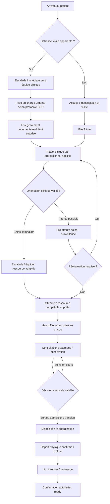
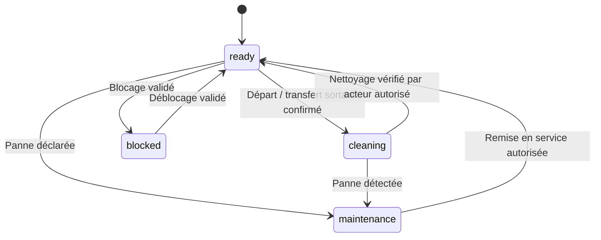

# PICU V4 — SMART EMERGENCY WORKFLOW
## Cahier d'implémentation et prompt maître pour agent de développement

**Projet :** PICU — Plateforme Intelligente de Coordination des Urgences, CHU Hassan II de Fès  
**Mission :** Faire évoluer le workflow opérationnel existant sans casser le socle V3.  
**Sources prioritaires :** `CHU_FES_EMERGENCY_PLATFORM_COMPLETE_ANALYSIS.md`, code source réel, migrations, tests et `PICU_V4_UI_UX_REFACTOR_IMPLEMENTATION.md` pour la cohérence UI.  
**Périmètre :** workflow métier, orchestration déterministe, alertes, réévaluations, affectation de ressources, transferts, supervision, API, données et tests. **Pas de déploiement clinique automatique.**

---

## 0. PROMPT À EXÉCUTER PAR L'AGENT

Tu es un **architecte logiciel senior full-stack, spécialiste des systèmes d'information hospitaliers, de la sûreté des workflows et des interfaces React**. Tu disposes du dépôt PICU. Lis d'abord ce document, l'analyse complète V3, puis le code. Ta mission est **d'implémenter progressivement PICU V4 Smart Emergency Workflow**, en conservant la compatibilité et la sécurité des données. Ne te contente pas de rédiger un plan : réalise les changements autorisés par phase, produis les migrations, tests et comptes rendus. **Ne touche jamais aux données réelles ou à une base de production.** Si tu ne disposes pas d'un environnement isolé, arrête-toi avant toute migration ou test destructif et fournis les instructions exactes.

### Règles non négociables

1. **Le code est la source de vérité technique.** Le Markdown V3 décrit le système mais n'est pas une preuve suffisante que tous les chemins fonctionnent. Vérifie fichiers, routes, contraintes, schéma et permissions.
2. **Préserver** les cinq rôles `receptionist`, `nurse`, `doctor`, `chief`, `admin`, le RBAC backend, l'audit `visit_events`, les transactions PostgreSQL, l'idempotence, les SSE et le fallback de rafraîchissement.
3. **Aucune IA requise pour le fonctionnement V4.** Les règles opérationnelles sont déterministes et explicables. NVIDIA NIM reste optionnel et ne peut pas prendre de décision clinique autonome.
4. **Aucune automatisation clinique non validée.** Le système ne définit ni ne modifie automatiquement la priorité P1–P5, la disposition médicale, la prescription ou le traitement. Les paramètres de réévaluation et d'escalade sont configurables et doivent être validés par le CHU.
5. **Les urgences vitales ne sont pas bloquées par l'interface.** Prévoir un parcours d'escalade immédiate et une saisie différée si nécessaire. Le logiciel ne remplace pas les procédures d'urgence hors ligne.
6. **Pas de fausse disponibilité.** Un lit libéré doit passer dans un état opérationnel de turnover (p. ex. `cleaning` ou autre état configuré), et ne redevient `ready` qu'après confirmation par un personnel autorisé. Ne jamais autoriser l'affectation automatique d'un lit en nettoyage.
7. **Ne pas inventer le protocole clinique du CHU.** Les définitions P1–P5, SLA, délais de réévaluation, restrictions de salles, critères de transfert et habilitations médicales nécessitent validation institutionnelle.
8. **Zéro perte de données.** Migrations additives et réversibles si possible ; transactions ; index et contraintes ; tests de concurrence ; pas de reset, seed ou purge de Neon de production.
9. **Pas de refonte graphique parallèle non coordonnée.** Exposer des composants et états compatibles avec le cahier UI/UX V4 ; préserver les fonctions et routes existantes.
10. **Ne jamais déclarer “implémenté” sans preuve** (fichiers modifiés, tests exécutés, limites et captures si disponibles).

---

## 1. BASELINE V3 À PRÉSERVER ET À VÉRIFIER

D'après l'analyse fournie, l'application utilise **React 19 / Vite / Tailwind**, **Node.js / Express**, **PostgreSQL Neon**, JWT/RBAC et SSE. Les principaux services annoncés sont `visitService.js`, `triageService.js`, `queueService.js`, `resourceService.js`, `staffService.js`, `careService.js`, `examTaskService.js` et `visitEventBus.js`. Vérifier leurs chemins réels.

### États existants à respecter

- `visits.status` : états historiques dont `waiting`, `placed`, `in_treatment`, états terminaux.
- `visits.care_stage` : `triage_pending`, `waiting_care`, `in_care`, `in_observation`, `disposition_pending`, `completed` et variantes réellement présentes.
- `patient_location` : localisation logique ; `bed_assignments` : occupation physique.
- Worklists : `triage`, `care`, `inCare`, `observation`, `disposition`, `reassessment`, `exams`.
- Tri actuel annoncé : `priority ASC, critical_flag DESC, arrived_at ASC, id ASC` ; le classement est **calculé**, pas stocké.
- Gestion des salles : `zones` → `rooms` → `beds`, `room_teams` et `room_team_nurses`.
- Endpoint SSE annoncé : `GET /api/events/stream`.

**Risques spécifiques documentés à corriger :** passage automatique d'un lit `cleaning` à `ready` lors de l'affectation ; libération de lit directement vers `ready` à la clôture ou au transfert ; priorité initiale renseignée à l'accueil pouvant être confondue avec un triage validé ; délégation de certaines actions médicales à l'infirmier qui doit être revue avec les responsables cliniques.

Avant toute modification, produire `docs/v4/00_BASELINE_AND_GAP_ANALYSIS.md` : état vérifié, chemins exacts, invariants, divergences du document V3 et risques de migration.

---

## 2. WORKFLOW CIBLE : PARCOURS PATIENT



### Règles d'implémentation

- **Enregistrement :** identifier patient existant, détecter visite active, permettre workflow d'urgence immédiate sans saisie préalable bloquante ; documenter qui régularise ensuite.
- **Triage :** distinguer **signalement initial non validé** et **priorité clinique validée**. Une valeur d'accueil ne doit jamais apparaître comme triage confirmé. Tracer auteur, date, justification, version et modifications.
- **Attente :** position calculée ; affichage priorité, temps écoulé, statut de triage, dernière réévaluation, appels, lieu et tâche suivante. Pas de sortie de file après simple appel.
- **Réévaluation :** produire une tâche due/overdue selon règles **configurées et validées**, sans changer automatiquement la priorité. Enregistrer décision et justification du soignant.
- **Placement :** ressource physiquement disponible **et** `operational_status=ready` **et** compatible selon règles locales validées ; vérifier permissions et concurrence transactionnelle.
- **Soins :** l'équipe responsable, les examens, l'observation et les blocages restent visibles ; le changement de responsable nécessite une traçabilité.
- **Disposition :** séparer décision médicale, organisation du départ et confirmation de sortie physique ; ne pas libérer le lit avant la fin réelle de l'occupation.
- **Turnover :** la sortie ou le transfert déclenche un état non assignable ; seul un acte de remise en disponibilité autorisé rétablit `ready`.

**Attention :** ne pas remplacer brutalement les états legacy ; proposer une stratégie de compatibilité avec `status`/`care_stage`, migration des données existantes et tests de transition.

---

## 3. MOTEUR SMART DE COORDINATION (SANS IA)

Implémenter un **moteur d'actions opérationnelles explicables**, indépendant de la priorité clinique.

### 3.1 Trois couches distinctes

1. **Priorité clinique** : uniquement donnée validée par personnel habilité.
2. **Worklist opérationnelle** : projection déterministe de l'état patient et des tâches.
3. **Recommandation opérationnelle** : proposition de prochaine action, avec motif, conditions et propriétaire ; aucune mutation clinique automatique.

### 3.2 Règles recommandées

- Patient non trié → tâche « Triage requis » à l'équipe habilitée.
- Signalement critique → alerte immédiate visible, accusé de réception et escalade selon protocole local ; ne jamais se contenter d'une position n°1.
- Réévaluation due → tâche « Réévaluer », avec durée depuis la dernière évaluation et seuil de configuration.
- Patient trié sans ressource → rechercher les **ressources compatibles prêtes**, sinon afficher « Blocage capacité » et proposer une escalade humaine.
- Patient placé sans équipe responsable → tâche « Affecter/contacter équipe ».
- Examens en attente → visibilité et suivi des tâches, sans inventer de délai médical.
- Décision de sortie prise mais patient encore présent → tâche de coordination, pas clôture anticipée.
- Lit en nettoyage → tâche de confirmation de remise en service, jamais affectation automatique.

### 3.3 Contrat d'une recommandation

```json
{
  "id": "recommendation-id",
  "type": "REASSESSMENT_DUE",
  "visitId": "visit-id",
  "priority": "high",
  "reasonCode": "REASSESSMENT_INTERVAL_EXCEEDED",
  "explanation": "Dernière évaluation au-delà du seuil configuré",
  "responsibleRole": "nurse",
  "action": "OPEN_REASSESSMENT",
  "requiresHumanConfirmation": true,
  "source": "deterministic_rule",
  "createdAt": "ISO-8601"
}
```

Cet objet est un **contrat proposé**, pas une API existante. `priority` dans ce contrat signifie priorité **opérationnelle de la tâche**, jamais priorité clinique P1–P5. Vérifier les noms de champs et conventions du dépôt avant intégration.

### 3.4 Exigences de stabilité

- Résultats déterministes pour mêmes données/configuration.
- Aucune action automatique destructrice ou clinique.
- Déduplication des alertes et tâches.
- Gestion d'acknowledgement, résolution, réouverture et historique.
- Pas de spam SSE ; invalider/refetch seulement les vues concernées.
- Calculs performants et indexés ; pagination pour historiques.

---

## 4. FILES D'ATTENTE ET RÉÉVALUATION

### Worklists V4

Conserver les sept listes V3, en améliorant leurs informations et actions :

| Liste | Contenu essentiel | Action principale |
|---|---|---|
| À trier | Patients non triés, durée depuis arrivée, signalement critique | Ouvrir triage |
| Attente soins | Priorité validée, durée, orientation, blocages | Proposer affectation |
| En soins | Salle, lit, équipe, étape de soins | Ouvrir dossier |
| Observation | Localisation, responsable, tâches dues | Suivi observation |
| Disposition | Décision, départ à coordonner, destination | Confirmer progression |
| À réévaluer | Dernière évaluation, délai configuré, statut | Réévaluer |
| Examens | Type, état, demandeur, attente | Voir/suivre examens |

Conserver la projection SQL existante sauf défaut prouvé ; documenter le comportement des priorités provisoires. Ne pas afficher des temps estimés de prise en charge comme des promesses. Les durées de réévaluation existantes (par exemple 60 minutes dans V3) sont des paramètres techniques **à valider cliniquement**.

---

## 5. SALLES, LITS ET TRANSFERTS

### 5.1 Modèle à deux axes

- **Occupation** : libre / occupé (dérivé de `bed_assignments`).
- **Disponibilité opérationnelle** : `ready`, `cleaning`, `maintenance`, `blocked`, `out_of_service` (préserver les valeurs existantes).

Un lit n'est **assignable** que si : actif, non occupé, `ready`, compatible avec la destination validée, utilisateur habilité et aucune autre réservation/affectation concurrente.

### 5.2 Cycle de turnover



Ne pas inférer qu'un lit en maintenance peut revenir directement à `ready` sans vérification : chaque transition doit avoir sa règle et sa trace. Éviter les transitions implicites cachées dans `placeVisit`, `closeVisit`, `returnVisit`, `transferResource`.

### 5.3 Transfert sécurisé

- Vérifier le patient et le lit cible, puis verrouiller les ressources dans un ordre déterministe.
- Enregistrer intention et statut du transfert si l'opération physique peut prendre du temps.
- Ne pas afficher le patient physiquement dans le lit cible avant confirmation du transfert.
- Finaliser atomiquement la nouvelle affectation et la libération de l'ancienne.
- Déclencher turnover sur le lit source, jamais `ready` automatique.
- Gérer annulation, expiration, conflit 409 et reprise après erreur.
- Préserver les transferts legacy et fournir une transition de compatibilité.

### 5.4 API proposée (à adapter aux conventions réelles)

- `GET /api/resources/board` : zones/salles/lits, occupation et état opérationnel.
- `POST /api/resources/beds/:id/mark-cleaning` : passage explicite en nettoyage.
- `POST /api/resources/beds/:id/confirm-ready` : remise en disponibilité autorisée et auditée.
- `POST /api/workflow/visits/:id/transfer-requests` : préparation transfert.
- `POST /api/workflow/transfers/:id/confirm` : confirmation physique et mutation transactionnelle.
- `POST /api/workflow/transfers/:id/cancel` : annulation sécurisée.

**Ne pas créer de routes en doublon** si les endpoints existants peuvent être étendus proprement.

---

## 6. ÉQUIPES, HANDOFFS ET RESPONSABILITÉS

- Conserver `room_teams` et `room_team_nurses`.
- Afficher le responsable actuel de chaque tâche et patient.
- Créer un workflow de passation pour les transferts et changements de responsabilité : initié → en attente d'acceptation → accepté/terminé, ou refusé/annulé.
- Consigner initiateur, destinataire, horodatages, raison, ancien/nouveau périmètre, et statut.
- Une passation en attente ne doit pas supprimer la responsabilité existante avant acceptation.
- Respecter les permissions de salle ; vérifier avec le CHU les actes que les infirmiers peuvent saisir au nom du médecin. Ne pas étendre ces permissions implicitement.

---

## 7. ALERTES ET SUPERVISION

### Types proposés

`CRITICAL_ESCALATION`, `UNTRIAGED_PATIENT`, `REASSESSMENT_DUE`, `CAPACITY_BLOCK`, `NO_ASSIGNED_TEAM`, `PENDING_EXAM`, `DISPOSITION_DELAY`, `BED_TURNOVER_PENDING`, `TRANSFER_BLOCKED`.

### Comportement

- Définir gravité opérationnelle, propriétaire, date, état (`open`, `acknowledged`, `resolved`), source et événement d'origine.
- Alerte critique : mise en évidence immédiate, notifications accessibles, voie d'escalade humaine ; ne jamais dépendre uniquement du navigateur/SSE pour l'appel clinique.
- Seuils configurables et validés ; éviter alarm fatigue, répétitions et faux positifs.
- Le chef de service voit le nombre d'alertes ouvertes, les patients concernés, la saturation, les ressources indisponibles, les transferts bloqués et les tâches en retard.
- Chaque action de supervision est auditée ; pas de « override » sans motif et contrôle d'habilitation.

---

## 8. FRONTEND V4 : INTÉGRATION AU REFACTOR UI/UX

Le document UI/UX V4 est la référence graphique. **Ne pas refaire un second design system.** Intégrer les nouveaux états dans les composants existants ou refactorés.

### Chef de service

- KPI compacts : patients actifs, critiques, à trier, en attente, lits prêts/occupés/en nettoyage, alertes ouvertes.
- Panneau « Actions prioritaires » trié par besoin d'intervention.
- Worklists filtrables et recherche, sans gigantesques cartes vides.
- Carte des salles/lits : état et occupation indépendants, actions contextuelles habilitées.
- Dossier patient dans un drawer conservant le contexte de navigation.
- Patients terminés dans un onglet/historique, pas au même niveau que les urgences actives.

### Accueil

- Enregistrement rapide, vérification des doublons, appel patient, signalement critique avec instruction d'escalade.
- Afficher clairement « priorité initiale non validée » jusqu'au triage autorisé.

### Infirmier

- Triage, réévaluations, patients à affecter, plan des lits, turnover et handoffs.
- Accès rapide au dossier sans perte de filtres.

### Médecin

- Patients attribués, consultations, examens, observation, disposition, tâches en attente.

### Admin

- Configuration technique et comptes ; pas d'accès clinique supplémentaire par le refactor.

### États UI obligatoires

Loading/skeleton, empty compact, erreur récupérable, accès refusé, données obsolètes, conflit 409, confirmation d'action, succès, reconnexion SSE, mode dégradé. Actions critiques avec confirmation appropriée, mais sans ralentir une escalade vitale. Accessibilité clavier, contraste, labels explicites, couleurs jamais seules porteuses de sens. Interfaces responsive desktop/tablette ; ne pas présumer que l'écran mobile est le poste clinique principal.

---

## 9. BASE DE DONNÉES ET MIGRATIONS

Inspecter le schéma réel avant de proposer des migrations. Ajouter **seulement si nécessaire** des structures telles que :

- `workflow_tasks` : type, visite, propriétaire, échéance, statut, raison, timestamps, version.
- `operational_alerts` : type, source, sévérité, état, acquittement, résolution, clé de déduplication.
- `handoff_requests` : visite, origine/destination, initiateur, acceptant, état, dates.
- `transfer_requests` : source/cible, état, validations, dates.
- `workflow_settings` : paramètres opérationnels approuvés et historisés.

Préférer étendre `care_tasks`, `resource_status_events`, `visit_events` et tables existantes lorsque cela évite des doublons. Documenter chaque choix et chaque contrainte. Ajouter index adaptés, clés étrangères, checks, règles d'unicité partielle et clés d'idempotence. Protéger toutes les mutations contre les doubles clics, retries et concurrence.

Plan de migration obligatoire : inspection → sauvegarde environnement de test → migration additive → backfill vérifié → déploiement compatible → tests → activation graduelle → rollback documenté. Ne pas lancer de migration sur la base Neon réelle sans approbation explicite.

---

## 10. BACKEND : ARCHITECTURE RECOMMANDÉE

Créer ou étendre des services cohérents, selon la structure réelle :

- `workflowOrchestratorService` : projection de tâches et recommandations déterministes.
- `operationalAlertService` : création, déduplication, acknowledgement, résolution.
- `reassessmentService` : calcul de tâches selon paramètres validés.
- `resourceService` : invariants de disponibilité et turnover.
- `handoffService` : coordination et acceptation des responsabilités.
- `queueService` : projections, filtres et métriques sans modifier les priorités cliniques.

Toutes les mutations passent par les contrôles RBAC existants, transaction DB, audit et événements SSE. Le frontend ne doit jamais devenir la source de vérité. Réutiliser les patterns existants plutôt que d'ajouter une architecture parallèle.

---

## 11. TESTS ET CRITÈRES D'ACCEPTATION

### Tests backend indispensables

1. Patient P1 critique : signalement et escalade visibles sans dépendre d'un classement de file.
2. Patient non trié : aucune priorité provisoire présentée comme triage clinique validé.
3. Réévaluation due : tâche générée ; aucune modification automatique de P1–P5.
4. Appel patient : incrément d'appel sans retrait de file.
5. Affectation simultanée même lit : une seule réussite ; l'autre conflit contrôlé.
6. Lit `cleaning` : affectation refusée même si non occupé.
7. Clôture/transfert : lit source non immédiatement `ready`.
8. Remise `ready` : nécessite utilisateur habilité et trace d'audit.
9. Transfert annulé : patient et ressources restent cohérents.
10. Handoff non accepté : responsabilité initiale conservée.
11. Double requête idempotente : aucun doublon d'événement ou d'affectation.
12. SSE déconnecté : interface indique données potentiellement obsolètes et rattrape l'état.
13. Permissions : accueil, infirmier, médecin, chef, admin testés côté API et UI.
14. Visite terminée : absente des listes actives, accessible dans l'historique.
15. Concurrence entre clôture, transfert et affectation : invariants respectés.

### Tests frontend

- Parcours complet sur données fictives, erreurs 401/403/409/500, états vides, latence, filtres, drawer, navigation clavier, responsive et actualisation temps réel.
- Tests d'intégration de chaque action UI avec l'API réellement existante.
- Vérifier qu'aucun bouton ne simule une action non implémentée.

### Critères de réussite

- Aucun changement silencieux de priorité clinique.
- Aucun lit non prêt proposé comme disponible.
- Aucune double affectation de ressource.
- Toutes les transitions sensibles traçables et autorisées.
- Les worklists restent cohérentes après chaque mutation.
- Les écrans des cinq rôles continuent de fonctionner.
- Tous les tests exécutables dans un environnement isolé passent ; les tests non exécutés sont explicitement listés.

---

## 12. PHASES D'EXÉCUTION DE L'AGENT

### Phase 0 — Audit et préparation (obligatoire)

Inspecter code, schéma, migrations, routes, tests, RBAC, SSE, données de démonstration et document UI. Écrire `docs/v4/00_BASELINE_AND_GAP_ANALYSIS.md`. Identifier le protocole CHU non connu et les points nécessitant validation. **Aucune mutation avant cet audit.**

### Phase 1 — Sécurité des états et ressources (P0)

Corriger la disponibilité des lits, les transitions de turnover, la distinction priorité initiale/triage validé et les chemins critiques. Tests transactionnels et compatibilité legacy. Produire `docs/v4/01_SAFETY_AND_RESOURCE_CHANGES.md`.

### Phase 2 — Worklists et réévaluation (P1)

Enrichir les listes et les tâches déterministes ; configurer les seuils sans inventer de protocole. Ajouter les tests de classement, réévaluation, idempotence. Produire `docs/v4/02_QUEUE_AND_REASSESSMENT.md`.

### Phase 3 — Coordination et handoffs (P1)

Créer les passations et transferts confirmés, les états de blocage, les contrôles RBAC et les audits. Produire `docs/v4/03_HANDOFF_AND_TRANSFER.md`.

### Phase 4 — Alertes et supervision (P1/P2)

Déduplication, acknowledgement, résolution, vues chef et SSE. Produire `docs/v4/04_ALERTS_AND_SUPERVISION.md`.

### Phase 5 — Intégration UI V4 (P1/P2)

Connecter les nouveaux états aux écrans Accueil, Infirmier, Médecin, Chef et Admin en respectant le cahier UI. Produire `docs/v4/05_UI_INTEGRATION.md`.

### Phase 6 — Validation finale (P0)

Tests, migration de test, revue sécurité et permissions, vérification de cohérence des données, documentation des limitations et démonstration fictive. Produire `docs/v4/06_VALIDATION_REPORT.md`.

**Après chaque phase :** fournir fichiers modifiés, endpoints créés/modifiés, migrations, tests réellement exécutés et résultats, limites, risques, rollback et prochaines actions. Ne pas enchaîner une phase dépendante si un invariant P0 échoue.

---

## 13. LIVRABLES ATTENDUS

- Code source modifié et maintenable.
- Migrations SQL vérifiées et instructions de rollback.
- Documentation API et schémas de transitions.
- Composants frontend intégrés au design system V4.
- Tests automatisés et rapport de résultats.
- Documents `docs/v4/00_...` à `06_...`.
- `docs/v4/SMART_WORKFLOW_FINAL_HANDOFF.md` : résumé du système réellement implémenté, preuves par fichier, fonctionnalités non réalisées, décisions cliniques à valider, instructions pour la soutenance.

## 14. DEFINITION OF DONE

PICU V4 Smart Emergency Workflow est considéré terminé **uniquement** si les invariants de sécurité sont satisfaits, les rôles restent correctement cloisonnés, les lits non prêts sont inassignables, les priorités restent sous contrôle clinique, les transitions et handoffs sont auditables, les worklists sont synchronisées, l'interface montre les vraies données backend et la suite de tests isolée est documentée.

**Instruction finale à l'agent :** Commence par la Phase 0, puis implémente phase par phase. N'invente pas de règles médicales ni de résultats de tests. Signale explicitement les décisions nécessitant validation par le CHU. Ne déploie pas en production et ne manipule pas de données réelles sans autorisation explicite.
