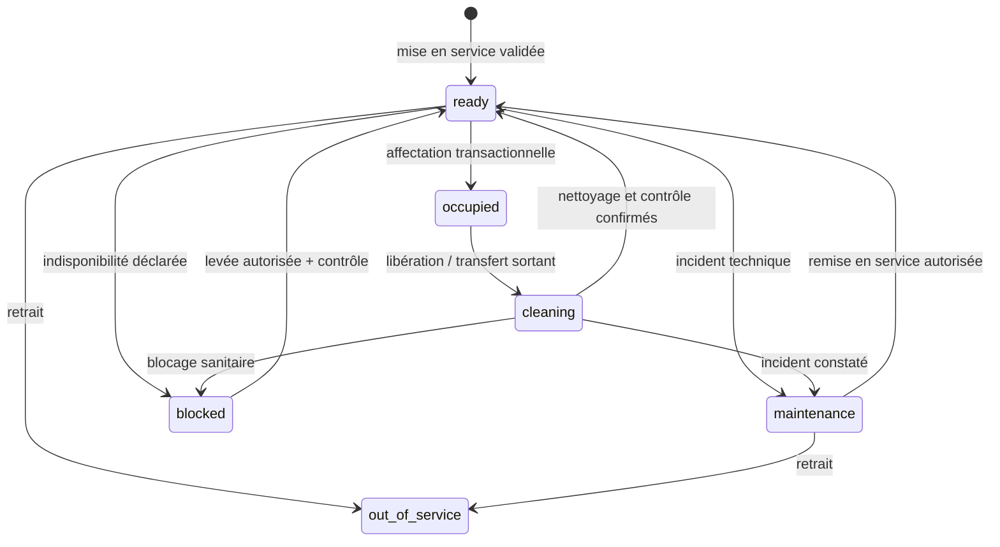

# PICU V4 — SMART RESOURCE MANAGEMENT
## Cahier des charges et prompt d'implémentation pour agent de développement

**Projet :** PICU — Plateforme Intelligente de Coordination des Urgences, CHU Hassan II de Fès  
**Phase :** V4 — Gestion intelligente des ressources (salles, lits, boxes, fauteuils et équipes)  
**Langue de l'interface :** français  
**Nature :** Spécification d'évolution full-stack, **sans dépendance à l'IA** ; compatible avec l'intégration future de NVIDIA NIM.  
**Références prioritaires :** `CHU_FES_EMERGENCY_PLATFORM_COMPLETE_ANALYSIS.md`, `PICU_V4_SMART_EMERGENCY_WORKFLOW_AGENT_PROMPT.md`, `PICU_V4_UI_UX_REFACTOR_IMPLEMENTATION.md` et **code réel du dépôt**. En cas de divergence, documenter l'écart avant toute modification.

---

# 0. PROMPT MAÎTRE — À LIRE PAR L'AGENT

Tu es un ingénieur logiciel senior full-stack spécialisé en systèmes hospitaliers, React, Node/Express, PostgreSQL, UX opérationnelle et fiabilité transactionnelle. Tu dois **implémenter progressivement** le module **PICU V4 Smart Resource Management** dans le dépôt existant, sans réécrire l'application et sans modifier arbitrairement les règles cliniques.

## Objectif général

Transformer la gestion actuelle des lits et salles en **système de coordination opérationnelle temps réel** : visibilité de l'occupation, disponibilité vérifiée, rotation et nettoyage, transferts sécurisés, affectation encadrée, équipes de salle, alertes de capacité et historique complet. Le module doit aider le personnel à prendre des décisions, **jamais décider d'un traitement ou d'un niveau d'urgence clinique à sa place**.

## Contraintes impératives

1. Inspecter les fichiers et schémas réels avant d'écrire du code ; ne pas supposer que les noms de colonnes ou endpoints décrits ici existent tels quels.
2. Préserver la machine à états `visits.status` / `visits.care_stage`, les 7 worklists, les permissions RBAC, les transactions PostgreSQL, les verrous, `visit_events`, les SSE et les interfaces existantes.
3. Ne jamais créer de seconde source de vérité pour l'occupation. **L'occupation réelle est dérivée des affectations actives** (`bed_assignments.released_at IS NULL`) ; le statut opérationnel indique la préparation/indisponibilité de la ressource.
4. Ne jamais rendre un lit `ready` automatiquement après la sortie ou le transfert d'un patient. Le statut `ready` requiert une **confirmation explicite et autorisée de disponibilité après nettoyage/contrôle**, selon le protocole validé localement.
5. Un lit `cleaning`, `maintenance`, `blocked` ou `out_of_service` n'est **pas attribuable**. Aucune suggestion ou interface ne doit contourner cette règle.
6. Les cas critiques ne doivent jamais être retardés par une étape administrative ou une interface : prévoir le signalement et l'escalade immédiats, mais ne pas inventer de protocole clinique.
7. Respecter les habilitations existantes ; proposer les nouvelles capacités en tant que **matrice à valider** par le CHU. L'admin informatique n'obtient aucun droit clinique.
8. Conserver les données médicales hors des logs de debug, des captures de démonstration et des payloads SSE non nécessaires. Tester avec des patients fictifs.
9. Ne pas effectuer de migrations destructrices, purge ou opérations sur la base de production. Utiliser un environnement de test isolé ; fournir un plan de retour arrière.
10. Pour chaque phase : code, tests, notes de migration, rapport des modifications, limites et preuves de validation.

---

# 1. ÉTAT EXISTANT À PRÉSERVER

D'après l'analyse V3 (à confirmer dans le dépôt) :

- Frontend : React 19, Vite, Tailwind CSS, Lucide, React Router ; dashboards `AccueilDashboardPage`, `NurseDashboardPage`, `DoctorDashboardPage`, `ChiefDashboardPage` ; composants `nurse/`, `chief/`, `workflow/`, `layout/`.
- Backend : Express ; services `resourceService.js`, `visitService.js`, `careService.js`, `staffService.js`, `queueService.js` ; routes REST protégées par RBAC.
- Modèle de ressources : `zones → rooms → beds`, avec `resource_type` (`bed`, `chair`, `box`, `triage_station`, `consultation_station`) et `operational_status` (`ready`, `cleaning`, `maintenance`, `blocked`, `out_of_service`).
- Affectations : `bed_assignments` ; occupation déterminée par une affectation active ; événements dans `resource_status_events` et `visit_events`.
- Transfert existant : `POST /api/care/visits/:id/transfer` ; placement : `POST /api/visits/:id/place` ; consultation et clôture déjà implémentées.
- Équipes : `room_teams`, `room_team_nurses`, gestion via `GET /api/chief/teams`, `PUT /api/chief/rooms/:id/team`, `DELETE /api/chief/rooms/:id/team`.
- Temps réel : `/api/events/stream`, hook `useVisitEventStream.js`, rechargement à l'événement et fallback polling.
- Problème identifié dans V3 : un lit peut passer de `cleaning` à `ready` au placement et est remis à `ready` après libération ; **corriger ce comportement avant de déployer les nouvelles vues**.

**Attention :** les détails ci-dessus proviennent du document d'analyse du projet, non d'un audit indépendant de ce prompt. L'agent doit les vérifier.

---

# 2. MODÈLE MÉTIER CIBLE

## 2.1 Deux dimensions indépendantes

| Dimension | Source de vérité | États / sens |
|---|---|---|
| Occupation | Affectation active en base | `occupied` ou `unoccupied`, dérivés, jamais édités manuellement |
| Disponibilité opérationnelle | `beds.operational_status` | `ready`, `cleaning`, `maintenance`, `blocked`, `out_of_service` |

**Disponible à l'affectation =** ressource active + `operational_status = ready` + aucune affectation active + contraintes de secteur/compatibilité satisfaites.

Un lit peut être **inoccupé mais indisponible** : exemple `cleaning`. L'UI ne doit jamais le compter parmi les lits immédiatement utilisables.

## 2.2 Cycle de vie du lit

`occupied` est un **état dérivé de l'affectation**, pas une valeur à ajouter à `operational_status`. Ne pas créer un statut `occupied` persistant concurrent.

### Règles de transition

- `ready → occupied` : uniquement par une opération de placement autorisée, transactionnelle, avec vérification atomique.
- `occupied → cleaning` : lors de toute libération effective du lit (sortie, transfert, retour en attente), sauf protocole local explicitement différent et validé.
- `cleaning → ready` : confirmation par un rôle habilité après nettoyage et contrôle ; conserver auteur, date et commentaire facultatif.
- `maintenance/blocked/out_of_service → ready` : réouverture contrôlée, motif et traçabilité obligatoires ; si nettoyage requis, transiter d'abord par `cleaning`.
- Les transitions interdites doivent renvoyer une erreur métier compréhensible (HTTP 409/422 selon conventions existantes).
- Une ressource occupée ne peut pas être déclarée libre, retirée du service ou réaffectée par simple mise à jour de statut.
- Ne jamais confondre **départ du patient**, **fin de nettoyage** et **remise en service**.

## 2.3 Typologie des salles

Conserver la configuration réellement stockée dans `zones`, `rooms`, `beds`. Les exemples SAUV/Déchoquage, surveillance rapide et ambulatoire servent à la visualisation, **pas** à coder en dur des règles médicales. Les contraintes de compatibilité clinique et de matériel doivent provenir d'un paramétrage validé, pas d'une heuristique arbitraire.

---

# 3. SMART BED BOARD — PLAN INTERACTIF

Créer ou refactoriser un **plan des salles et lits** utilisable par le chef de service et les soignants autorisés.

## 3.1 Vue d'ensemble

- Filtres par zone, salle, type de ressource, état opérationnel, occupation, disponibilité et équipe.
- KPIs : total ressources actives, occupées, disponibles immédiatement, en nettoyage, en maintenance, bloquées, hors service ; afficher le périmètre et l'heure de mise à jour.
- Carte par salle avec capacité `occupés / actifs`, disponibilité réelle, médecin responsable et équipe affectée si autorisé.
- Grille des ressources : identifiant lisible, état, durée d'occupation ou de nettoyage, patient affecté uniquement pour les rôles habilités.
- Légende accessible avec **texte + icône + couleur** ; ne pas dépendre uniquement des couleurs.
- États de chargement, absence de données, erreur, données périmées, perte SSE et permissions insuffisantes.
- Recherche rapide par numéro de lit ou salle.

## 3.2 Détail d'une ressource (drawer)

Afficher : salle/zone, type, statut, disponibilité, occupation, horodatage des changements, responsable du dernier changement, historique récent, actions permises.

Actions conditionnelles :

- Affecter un patient éligible.
- Transférer vers une ressource éligible.
- Déclarer « nettoyage en cours » / « nettoyage terminé ».
- Signaler maintenance / blocage avec motif.
- Remettre en service selon validation des habilitations.
- Consulter l'historique des événements.

Chaque action doit afficher l'état réel rechargé et être **désactivée** si interdite, avec raison lisible ; le backend reste l'autorité finale.

## 3.3 Interaction avec les files

Depuis la worklist « attente soins », ouvrir « Affecter une ressource » ; montrer uniquement les ressources réellement disponibles et compatibles avec les contraintes explicitement configurées. Après confirmation, mettre à jour la visite, l'affectation, le bed board, les worklists et les KPIs via SSE.

---

# 4. SMART ALLOCATION — AIDE À L'AFFECTATION

## 4.1 Suggestions déterministes, explicables

Créer un service **non clinique** qui propose des ressources éligibles sans décider seul. Critères possibles, uniquement si les données existent et sont fiables :

1. Disponibilité vérifiée (`ready`, non occupé, actif).
2. Contraintes de secteur et type de ressource configurées.
3. Équipe de salle disponible ou assignée (indicateur opérationnel, pas substitut à un jugement clinique).
4. Équilibrage de charge opérationnelle à égalité de compatibilité.
5. Stabilité et ordre déterministe (identifiant en dernier critère).

**Interdit :** suggérer un lit incompatible sur la base d'un score, modifier la priorité P1–P5, déplacer un patient automatiquement, ou prétendre déterminer la pertinence clinique d'une salle sans protocole validé.

## 4.2 Résultat attendu

Pour chaque suggestion : `bedId`, salle, zone, statut, raisons factuelles, avertissements, version/horodatage des données. Les raisons doivent être auditées et affichables : « prêt », « aucune affectation active », « salle configurée pour ce type de ressource ».

Si aucune ressource admissible : état **« Aucune ressource disponible »**, explication agrégée et proposition d'escalade humaine, jamais affectation forcée.

## 4.3 Confirmation

L'utilisateur choisit une ressource et confirme. Le backend **revalide tout dans la transaction**. Une suggestion devenue obsolète ne doit pas produire de double occupation : renvoyer 409, recharger les options et afficher « Cette ressource n'est plus disponible ».

---

# 5. SMART TURNOVER — NETTOYAGE ET REMISE EN SERVICE

## 5.1 Workflow

1. Patient quitte physiquement la ressource ; libération enregistrée.
2. La ressource devient inoccupée mais `cleaning` (non attribuable).
3. Une tâche opérationnelle de nettoyage/contrôle est visible dans le bed board ; si aucune table de tâches adaptée n'existe, concevoir une migration minimale ou réutiliser une structure existante après audit.
4. Le personnel habilité confirme la fin du nettoyage et le contrôle de disponibilité.
5. La ressource passe à `ready`, événement historisé, KPIs et SSE mis à jour.

Ne pas prétendre que la plateforme vérifie matériellement le nettoyage : elle **enregistre une déclaration humaine**.

## 5.2 Détails d'implémentation

- Corriger **tous** les chemins de libération : `closeVisit`, `completeVisit`, `return`, `transferResource` et toute autre fonction trouvée par recherche de `operational_status='ready'` ou équivalent.
- Vérifier les impacts sur les tests existants, le seed et les données de démonstration.
- Prévoir une reprise de données des lits historiquement marqués `ready` après libération : **ne pas déduire rétroactivement qu'ils ont été nettoyés**. Produire une procédure de revue humaine et une stratégie de migration prudente.
- Les temps de nettoyage peuvent être affichés, mais aucun seuil automatique de disponibilité ne doit être inventé.
- Une panne SSE ne doit jamais permettre une action sur un état local périmé.

---

# 6. TRANSFERTS SÉCURISÉS ET CONTINUITÉ DE SOINS

## 6.1 Scénario standard

- Sélectionner patient, lit source et lit cible.
- Vérifier droits du demandeur, visite active, affectation source actuelle, disponibilité de la cible et contraintes de secteur.
- Afficher confirmation avec **source → destination**.
- Effectuer le transfert en **une transaction atomique** : verrouiller les enregistrements pertinents dans un ordre stable ; fermer l'affectation source ; créer l'affectation cible ; marquer source `cleaning` ; écrire événements d'audit ; publier SSE après commit.
- Si conflit, annuler la transaction entière et afficher une erreur récupérable.

## 6.2 Cas particuliers

- Transfert vers une autre zone/salle : afficher changement d'équipe et besoin éventuel de passation.
- Patient en observation : préserver l'état clinique et l'historique.
- Patient critique : ne pas imposer d'étapes bloquantes non validées ; afficher un chemin d'escalade humaine.
- Annulation d'une sélection avant confirmation : aucune mutation.
- Répétition accidentelle du clic : empêcher un double transfert (idempotence ou détection robuste).

---

# 7. COORDINATION DES SALLES ET ÉQUIPES

Conserver `room_teams`, `room_team_nurses` et les restrictions existantes. Ajouter une vue opérationnelle « Équipes & Salles » :

- Salle, zone, médecin titulaire, infirmiers rattachés, charge de patients et capacité de ressources.
- Salles sans équipe affectée, sans médecin titulaire, ou avec configuration incomplète : **anomalie de coordination**, pas diagnostic clinique.
- Actions de gestion des équipes réservées aux capacités existantes ou nouvelles capacités approuvées.
- Pour une réaffectation d'équipe pendant qu'une salle contient des patients : avertissement, confirmation et traçabilité ; vérifier l'impact sur l'accès aux dossiers et les opérations en cours.
- Handoff explicite si le workflow V4 le permet : initiateur, destinataire, visite/salle, motif opérationnel, date, état d'accusé de réception. Ne pas introduire de passation automatique présumée acceptée.

---

# 8. CAPACITÉ, TENSION ET ALERTES OPÉRATIONNELLES

## 8.1 Indicateurs fiables

- Taux d'occupation = ressources occupées / ressources actives **du périmètre choisi** ; préciser si des types de ressources sont exclus.
- Disponibilité immédiate = ressources `ready` et sans affectation active.
- Ressources en nettoyage, bloquées, maintenance, hors service.
- Nombre de patients en attente de ressource selon la worklist existante.
- Durées d'occupation, de nettoyage et d'attente **calculées à partir des horodatages existants**.
- Charge par salle et par zone.

Ne jamais afficher un taux trompeur sans expliquer son dénominateur. Un lit `cleaning` ne doit pas être compté disponible.

## 8.2 Alertes

Définir des alertes déterministes et non diagnostiques :

- Aucune ressource immédiatement disponible dans une zone.
- Ressource en nettoyage depuis une durée dépassant un **seuil paramétré et approuvé**.
- Salle active sans équipe assignée.
- Patient en attente de lit alors qu'aucune ressource admissible n'existe.
- Incohérence détectée entre statut opérationnel et affectation active.
- Événement de transfert ou libération en erreur.

Pour chaque alerte : identifiant, catégorie, gravité **opérationnelle**, origine, date, salle/ressource, état (`open`, `acknowledged`, `resolved`), utilisateur responsable si attribué, lien vers action. Ne pas confondre gravité opérationnelle et priorité clinique P1–P5.

Les seuils, destinataires et procédures d'escalade doivent être validés avec le CHU ; fournir des paramètres sans inventer de valeurs médicales.

---

# 9. API ET SERVICES — CONTRATS À ADAPTER AU DÉPÔT

**Ne pas créer des doublons d'endpoints existants.** L'agent doit dresser la cartographie actuelle puis proposer une extension minimale. Contrats cibles indicatifs :

| Méthode / route proposée | Fonction | Autorisation |
|---|---|---|
| `GET /api/resources/board` | Vue zones/salles/ressources/occupation et métriques | Rôles soignants habilités |
| `GET /api/resources/:id` | Détail ressource + état | Selon rôle et périmètre |
| `GET /api/resources/:id/history` | Historique opérationnel | Selon rôle |
| `POST /api/resources/:id/mark-cleaning` | Déclarer nettoyage | Capacité dédiée à valider |
| `POST /api/resources/:id/confirm-ready` | Confirmer nettoyage/contrôle | Capacité dédiée à valider |
| `POST /api/resources/:id/operational-status` | Maintenance/blocage/retrait | Capacité dédiée à valider |
| `GET /api/resources/eligible?visitId=...` | Ressources admissibles, raisons | Infirmier/chef habilités |
| `GET /api/resources/capacity` | Statistiques de capacité | Chef/soignants autorisés |
| `GET /api/resources/alerts` | Alertes opérationnelles | Selon rôle |

Réutiliser `POST /api/visits/:id/place` et `POST /api/care/visits/:id/transfer` **plutôt que créer des variantes incompatibles**. Ne pas changer silencieusement les formats existants ; versionner ou étendre de façon rétrocompatible.

### Principes API

- Validation stricte des entrées ; erreurs 400/401/403/404/409/422 cohérentes.
- Vérification RBAC côté serveur ; contrôle du périmètre de salle.
- Transactions et verrous pour toutes les mutations concurrentes.
- Horodatages UTC en stockage, affichage localisé.
- Pagination pour historiques volumineux.
- Réponses minimisées selon le rôle ; pas de données patient superflues.
- SSE publié **après commit**, avec identifiants permettant un rafraîchissement ciblé et sans divulgation de données sensibles.

---

# 10. BASE DE DONNÉES ET MIGRATIONS

L'agent doit d'abord inspecter les migrations et tables existantes (`beds`, `bed_assignments`, `resource_status_events`, `room_teams`, `visit_events`, éventuelles tables de tâches et d'alertes).

Créer uniquement les éléments réellement absents, par exemple :

- Historique enrichi des transitions de ressource : ancien statut, nouveau statut, raison, auteur, horodatage, identifiant de visite éventuel.
- Confirmation de nettoyage/contrôle : identifiant de ressource, auteur habilité, date, note facultative ; éviter toute duplication si `resource_status_events` suffit.
- Alertes opérationnelles persistantes seulement si le cycle acknowledgment/résolution l'exige ; sinon utiliser une projection calculée.
- Paramétrage de seuils non cliniques et de règles d'éligibilité, si nécessaire.

### Contraintes de données

- Préserver l'unicité de l'affectation active par ressource et par visite.
- Ajouter des index sur les colonnes de filtrage/horodatage seulement après analyse du schéma et du plan de requêtes.
- Ne jamais stocker une copie modifiable du booléen `occupied`.
- Migration additive, réexécutable si possible, avec script de rollback documenté.
- Ne pas modifier des statuts historiques en masse sans validation humaine.

---

# 11. UI/UX — INTÉGRATION AVEC PICU V4

## 11.1 Navigation proposée

Dans la navigation existante, exposer selon rôle :

- **Salles & lits** : plan temps réel et filtres.
- **Affectations** : patients à placer et ressources admissibles.
- **Nettoyage & disponibilité** : ressources en rotation.
- **Équipes de salle** : coordination (chef).
- **Alertes de capacité** : anomalies et suivi.

Ne pas créer cinq pages obligatoires si un espace à onglets est plus efficace : respecter le design system V4 déjà planifié.

## 11.2 Écran Chef de Service

Ordre de priorité visuelle : bandeau synthétique (patients actifs, lits immédiatement disponibles, lits en nettoyage, alertes), **plan des ressources**, patients en attente d'affectation, anomalies/alertes, équipes. Les visites terminées restent dans l'historique, pas dans la zone principale de coordination.

## 11.3 Écran Infirmier

Accès direct aux patients en attente de lit, plan de sa salle, affectation, transfert, confirmation de nettoyage **si habilité**, alertes pertinentes. Les actions non autorisées restent cachées ou explicitement indisponibles ; le serveur vérifie toujours les permissions.

## 11.4 Composants suggérés

`ResourceBoard`, `ZoneSummary`, `RoomCard`, `ResourceTile`, `ResourceDetailsDrawer`, `ResourceStatusBadge`, `EligibleResourcePicker`, `TransferDialog`, `CleaningQueue`, `CapacityKpiRow`, `ResourceAlertsPanel`, `RoomTeamPanel`.

Adapter les noms au dépôt. Extraire des composants existants avant d'en créer de nouveaux.

## 11.5 UX critique

- Actions majeures accessibles en 1–3 interactions depuis le contexte de travail.
- Confirmation explicite pour transferts, indisponibilité et remise en service.
- États de conflit, chargement, succès et erreur compréhensibles.
- Contrôles clavier, focus visible, libellés accessibles, contrastes adéquats.
- Pas de données patients dans les toasts affichés sur écrans partagés si elles ne sont pas nécessaires.
- Pas de « drag & drop » comme unique moyen d'affecter ou transférer : offrir une alternative accessible avec confirmation.

---

# 12. TEMPS RÉEL, CONCURRENCE ET RÉSILIENCE

- Réutiliser `useVisitEventStream` et le bus SSE ; étendre les événements ressources si nécessaire.
- Événements suggérés : `resource_status_changed`, `resource_assigned`, `resource_released`, `resource_transferred`, `room_team_changed`, `capacity_alert_changed`.
- Éviter les rafraîchissements en boucle ; dédupliquer et regrouper les événements rapprochés.
- Maintenir le polling de secours existant.
- Afficher la date du dernier rafraîchissement et une bannière « données potentiellement obsolètes » lors d'une déconnexion prolongée.
- Toute action d'écriture revalide les conditions en base même si l'UI affiche encore `ready`.
- Tester deux utilisateurs qui tentent simultanément le même lit : un seul doit réussir.

---

# 13. SÉCURITÉ ET GOUVERNANCE

- Matrice des droits actuelle : `nurse`/`chief` pour placement et transfert ; `chief` pour gestion d'équipes ; `admin` informatique sans droits cliniques. **Nouvelles capacités de nettoyage, maintenance et remise en service à définir avec l'établissement**, sans attribution implicite à un rôle non validé.
- Journaliser les changements opérationnels avec acteur réel, horodatage, état précédent, état suivant et justification.
- Ne pas modifier les priorités cliniques via ce module.
- Ne pas permettre à un moteur IA de confirmer le nettoyage, l'ouverture d'un lit, un transfert ou une décision clinique sans les autorisations et validations requises.
- Ne pas exposer des dossiers patients à un rôle non autorisé via les endpoints de supervision.
- Protéger les actions de mutation contre les doubles clics et requêtes concurrentes ; ne pas se reposer sur les seuls boutons désactivés.

---

# 14. PLAN D'EXÉCUTION OBLIGATOIRE

## Phase 0 — Audit et cartographie (aucune modification)

- Inspecter composants, routes, services, SQL, permissions, tests et SSE.
- Inventorier tous les chemins qui rendent une ressource `ready`.
- Cartographier les invariants d'affectation et les dépendances du workflow V4.
- Produire `docs/v4-resource-audit.md` avec écarts, risques, changements proposés et fichiers ciblés.

**Critère de sortie :** aucun changement métier non compris ; liste exhaustive des chemins de libération.

## Phase 1 — Correctifs de sécurité des ressources (P0)

- Supprimer le passage implicite `cleaning → ready` au placement.
- Empêcher toute affectation de ressource non `ready`.
- Passer les ressources libérées en `cleaning` dans **tous** les chemins pertinents.
- Ajouter confirmation autorisée de remise en service.
- Ajouter tests de non-régression et de concurrence.

**Critère de sortie :** aucune ressource non prête n'est attribuable, aucune sortie ne la rend prête automatiquement.

## Phase 2 — API et projections de capacité (P1)

- Construire la vue consolidée ressources/occupation et les métriques.
- Exposer historiques et filtres sans fuite de données.
- Ajouter validations, erreurs métier et SSE ressources.

**Critère de sortie :** compteurs exacts, cohérents après chaque mutation.

## Phase 3 — Bed Board interactif (P1)

- Intégrer plan zones/salles/ressources, drawer, états et filtres.
- Brancher sur API réelle et SSE ; aucun faux compteur codé en dur.
- Respecter design system V4, permissions et accessibilité.

**Critère de sortie :** visualisation synchronisée et actions correctement protégées.

## Phase 4 — Affectation assistée et transferts (P1)

- Implémenter filtrage déterministe et raisons des suggestions.
- Intégrer sélection/confirmation et gestion des conflits.
- Garantir transfert atomique, nettoyage du lit source et continuité de la visite.

**Critère de sortie :** aucune double occupation, aucun transfert partiel.

## Phase 5 — Équipes, alertes et supervision (P2)

- Vue équipes/salles, anomalies de configuration, capacité et alertes.
- Ajouter acquittement/résolution uniquement si approuvés.
- Intégrer au dashboard Chef sans surcharger l'interface.

**Critère de sortie :** alertes compréhensibles, non cliniques et actionnables.

## Phase 6 — Validation et livraison (P0 avant déploiement)

- Tests unitaires, intégration, concurrence, RBAC, UI et end-to-end.
- Documentation utilisateur par rôle et guide d'exploitation.
- Audit des changements SQL et rollback.
- Démonstration avec données fictives et validation des protocoles locaux.

**Critère de sortie :** rapport de tests reproductible et liste des points à approuver par le CHU.

---

# 15. MATRICE DE TESTS ET ACCEPTATION

| ID | Scénario | Résultat attendu |
|---|---|---|
| RM-01 | Deux infirmiers attribuent simultanément le même lit | Un succès maximum ; second reçoit 409 ; aucune double occupation |
| RM-02 | Lit `cleaning` sélectionné pour placement | Refus côté API et UI ; aucune conversion implicite en `ready` |
| RM-03 | Clôture d'une visite occupant un lit | Affectation fermée, lit `cleaning`, non disponible |
| RM-04 | Transfert A → B | B occupé, A en nettoyage, une seule affectation active patient |
| RM-05 | Échec pendant transfert | Rollback intégral ; A reste affecté, B libre |
| RM-06 | Confirmation nettoyage par rôle non habilité | 403 ; aucun changement d'état |
| RM-07 | Confirmation nettoyage par rôle habilité | Lit `ready`, événement et auteur enregistrés |
| RM-08 | Maintenance / blocage | Ressource exclue des propositions et de la disponibilité |
| RM-09 | Perte SSE puis reconnexion | Indicateur de fraîcheur, rattrapage et état correct |
| RM-10 | Suggestions devenues obsolètes | Revalidation serveur, conflit explicite, options actualisées |
| RM-11 | Salle sans équipe | Alerte de coordination ; aucune décision clinique automatique |
| RM-12 | Historique ressource | États, acteur, motif et horodatages cohérents |
| RM-13 | Utilisateur accueil / admin | Aucune mutation ressource hors permissions |
| RM-14 | Dossiers de deux salles | Respect strict des restrictions de périmètre |
| RM-15 | Lit libéré après `return` | Lit non attribuable tant que nettoyage non confirmé |
| RM-16 | Tableau de bord | `ready` inoccupé uniquement dans « disponibles » ; `cleaning` séparé |
| RM-17 | Aucun lit éligible | Message et escalade humaine ; aucune affectation forcée |
| RM-18 | Requête répétée / double clic | Pas de double transfert ni de double confirmation incohérente |
| RM-19 | Patient actif en observation | Transfert préserve le stade clinique et la traçabilité |
| RM-20 | Démonstration fictive | Aucune donnée réelle ou secret exposé dans captures/logs |

**Definition of Done :** les tests P0 passent sur une base isolée ; les invariants sont documentés ; le chef et les soignants disposent d'une vue fiable ; les permissions sont appliquées côté serveur ; les changements sont compatibles avec le Smart Workflow V4 et le refactor UI.

---

# 16. LIVRABLES EXIGÉS DE L'AGENT

Créer ou mettre à jour :

1. `docs/v4-resource-audit.md` — inventaire et écarts constatés.
2. `docs/v4-resource-architecture.md` — schémas, flux, contrats, transitions et invariants.
3. `docs/v4-resource-rbac.md` — matrice des permissions existantes et nouvelles capacités à valider.
4. `docs/v4-resource-test-report.md` — commandes, résultats, tests non exécutés et raisons.
5. `docs/v4-resource-migration-runbook.md` — migrations, sauvegarde, rollback et traitement prudent des statuts historiques.
6. `docs/v4-resource-changelog.md` — liste des fichiers modifiés, décisions, risques résiduels et instructions d'utilisation.
7. Code source et tests effectifs, sans fonctionnalités fictives ni boutons inactifs.

## Format du rapport final

- **État :** implémenté / partiellement implémenté / bloqué.
- **Phases achevées** et preuves.
- **Fichiers modifiés** et raison.
- **Endpoints et migrations** créés ou réutilisés.
- **Tests exécutés** (commandes et résultats exacts).
- **Décisions nécessitant validation hospitalière**.
- **Risques résiduels** et prochaine action recommandée.

---

# 17. COMPATIBILITÉ FUTURE NVIDIA NIM — SANS ACTIVER L'IA

Concevoir les services pour exposer ultérieurement une **lecture structurée et minimisée** de la capacité, des ressources éligibles, des alertes et des contraintes opérationnelles. L'IA pourra proposer des options **explicables**, mais ne doit pas devenir la source de vérité, écrire directement en base, certifier le nettoyage ou exécuter des transferts sans contrôle d'accès et approbation humaine. Ne pas ajouter de clé API, de fournisseur ou de dépendance IA dans cette phase.

---

# 18. INSTRUCTION FINALE À L'AGENT

> Lis intégralement cette spécification et les documents V3/V4 présents dans le dépôt. Commence par l'audit Phase 0. Implémente ensuite les phases dans l'ordre, avec priorité absolue aux invariants de disponibilité et de non-double-affectation. Réutilise l'architecture et le design system existants ; ne réécris pas l'application. Ne change aucune règle clinique sans validation explicite. Après chaque phase, exécute les tests disponibles et consigne les résultats. N'affirme jamais qu'un test a réussi s'il n'a pas été exécuté. Si une décision dépend d'un protocole hospitalier ou d'une permission non définie, documente le point bloquant et utilise un comportement sûr par défaut. Livre le code, les migrations et les documents demandés.
