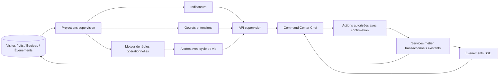
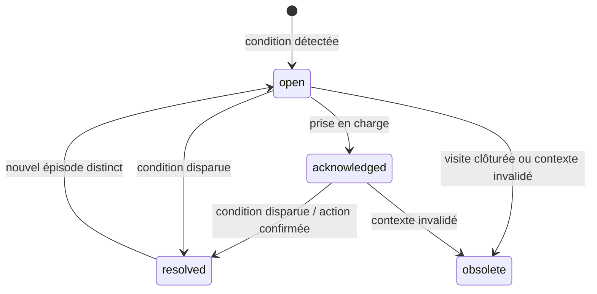

# PICU V4 — SMART SUPERVISION & OPERATIONAL COMMAND CENTER
## Cahier des charges complet et prompt maître pour agent de développement

**Projet :** PICU — Plateforme Intelligente de Coordination des Urgences, CHU Hassan II de Fès  
**Périmètre :** Supervision opérationnelle, alertes, goulots d'étranglement, coordination et tableaux de bord en temps réel.  
**Version :** V4 — phase Smart Supervision  
**Langue de l'interface :** français  
**Nature :** spécification d'implémentation, à adapter après vérification du dépôt réel.

---

# 0. PROMPT MAÎTRE À EXÉCUTER

Tu es un agent de développement senior full-stack spécialisé en applications hospitalières critiques. Ta mission est d'implémenter la **Smart Supervision V4** dans le dépôt PICU existant, sans casser les parcours patient, la gestion des ressources, les droits des soignants ou les mécanismes d'audit.

**Documents à lire en premier, s'ils sont présents :**
1. `CHU_FES_EMERGENCY_PLATFORM_COMPLETE_ANALYSIS.md` — référence descriptive de la V3, à vérifier contre le code.
2. `PICU_V4_SMART_EMERGENCY_WORKFLOW_AGENT_PROMPT.md` — workflow V4.
3. `PICU_V4_SMART_RESOURCE_MANAGEMENT_AGENT_PROMPT.md` — ressources et capacité.
4. `PICU_V4_UI_UX_REFACTOR_IMPLEMENTATION.md` — design system et UX.

**Instruction essentielle :** inspecte d'abord le code réellement présent, les migrations et les tests. Les documents peuvent décrire des fonctionnalités non encore implémentées. Distingue `EXISTANT`, `PARTIEL`, `ABSENT`, `À MODIFIER`. Ne suppose jamais qu'une phase précédente a été appliquée.

**Ne réalise aucune opération destructive** sur la base Neon ou des données cliniques. Pas de reset, de seed ou de migration de production sans accord explicite. Utilise un environnement de développement isolé et des données fictives.

**Sécurité clinique :** la supervision aide les équipes à détecter, prioriser et coordonner les actions opérationnelles ; elle ne pose pas de diagnostic, ne change pas la priorité P1–P5, ne prescrit pas, n'ordonne pas de sortie et n'exécute pas d'action clinique autonome. Les seuils cliniques doivent être approuvés par le CHU ; aucun seuil inventé ne doit être présenté comme norme hospitalière.

---

# 1. SOCLE EXISTANT ET INTÉGRATION

Selon l'analyse V3 fournie, le projet utilise React 19 / Vite / Tailwind / Lucide / React Router, Express / Node.js, PostgreSQL Neon, des endpoints REST, une authentification JWT avec RBAC, et un flux SSE `GET /api/events/stream` avec polling de secours. Vérifier les versions et chemins exacts.

Modules à préserver et réutiliser autant que possible :
- `ChiefDashboardPage`, composants `components/chief/` et `components/workflow/` ;
- `ChiefVisitDrawer` ou équivalent ;
- `queueService.js` et `GET /api/queue/worklists` ;
- `resourceService.js`, `staffService.js`, `careService.js` ;
- `useVisitEventStream.js` et mécanismes SSE existants ;
- `visit_events` pour la traçabilité métier ;
- `visits.status`, `visits.care_stage`, `patient_location` ;
- `beds.operational_status`, `bed_assignments`, `room_teams` ;
- capacités RBAC déclarées dans `backend/src/config/roles.js`.

**Sept worklists de référence :** `triage`, `care`, `inCare`, `observation`, `disposition`, `reassessment`, `exams`. Ne pas les fusionner de manière destructive ; produire des projections supplémentaires pour la supervision.

**Priorisation existante :** préserver l'ordre calculé côté serveur : `priority ASC, critical_flag DESC, arrived_at ASC, id ASC`. Ne jamais modifier une priorité clinique pour optimiser des KPI.

---

# 2. OBJECTIFS MÉTIER

Créer un **centre de commandement opérationnel** qui permet au Chef de Service de répondre immédiatement à ces questions :

1. Combien de patients sont présents, et à quelles étapes ?
2. Quels patients ou tâches nécessitent une intervention ou une réévaluation par un soignant autorisé ?
3. Où le flux est-il ralenti (triage, attente soins, examens, observation, orientation, nettoyage des lits) ?
4. Quelles ressources sont prêtes, occupées, en nettoyage, bloquées ou hors service ?
5. Quelles équipes et salles ont une charge élevée ou des tâches en attente ?
6. Quelles alertes sont nouvelles, prises en charge, résolues ou obsolètes ?
7. Quelle action opérationnelle peut être proposée, avec justification et confirmation humaine ?

**Principe UX :** dashboard *action-first*, pas une succession de cartes statistiques ni une vitrine de patients clôturés. En l'absence de patients actifs, les vues se compactent et affichent un état vide clair. Les visites terminées sont consultables dans l'historique, pas dans le pipeline principal.

---

# 3. ARCHITECTURE FONCTIONNELLE CIBLE



- **Source de vérité :** tables métier et événements validés, jamais l'état local du navigateur.
- **Projections :** calculs côté serveur, cohérents et explicables.
- **Alertes :** distinction entre condition détectée, notification et action humaine.
- **Recommandations :** déterministes, non cliniques, explicables, non exécutées automatiquement.
- **Actualisation :** SSE + récupération après reconnexion + polling de secours, sans boucle de rafraîchissement agressive.

---

# 4. DASHBOARD CHEF DE SERVICE — PRIORITÉ P1

## 4.1 Structure visuelle

Sur desktop :

1. **En-tête compact :** `Supervision des urgences`, état de connexion, dernière synchronisation, filtres de secteur, recherche de visite, bouton de rafraîchissement manuel.
2. **Bandeau de KPI :** patients actifs, en attente de triage, en attente de soins, patients en soins, alertes ouvertes, lits réellement prêts, lits occupés.
3. **Zone d'attention immédiate :** alertes actives triées par gravité opérationnelle, ancienneté et état de prise en charge.
4. **Pipeline actif :** triage → attente soins → en soins → observation → disposition ; colonnes adaptatives, nombres et accès aux patients.
5. **Plan de capacité :** disponibilité par zone/salle, lits en nettoyage, maintenance, blocage, occupation.
6. **Coordination :** tâches et handoffs, équipes de salle, actions en attente.
7. **Analyse des flux :** délais observés et goulots, avec période de mesure explicite.
8. **Historique et audit :** section secondaire ou page dédiée.

Sur écran étroit : priorité aux alertes et à la file active ; onglets pour ressources et équipes. Ne pas imposer un Kanban horizontal illisible.

## 4.2 KPI et définitions

| Indicateur | Définition attendue | Précautions |
|---|---|---|
| Patients actifs | Visites non clôturées, selon états réels du dépôt | Pas de doublon entre worklists |
| En attente de triage | Visites `triage_pending` / états compatibles | Cohérent avec worklist `triage` |
| En attente de soins | Visites éligibles à la worklist `care` | Distinguer attente avec/sans lit si possible |
| En soins | Visites en cours de soins | Ne pas compter automatiquement toutes les observations |
| Alertes ouvertes | Alertes non résolues et non obsolètes | Dédupliquer par entité + règle |
| Lits prêts | `ready` et sans affectation active | `cleaning` n'est jamais `ready` |
| Occupation | Affectations actives / ressources pertinentes | Afficher numérateur et dénominateur |
| Durée d'attente | Temps calculé à partir des timestamps métier | Afficher unité et population mesurée |

**Aucune donnée fictive** dans les KPI de production. Afficher `—` et une explication si une mesure n'est pas disponible ou fiable. Éviter les pourcentages trompeurs sur de petits effectifs.

## 4.3 Vue patient/action

Chaque ligne doit permettre de voir selon les droits : identifiant de visite, priorité validée, étape, zone/salle/lit, temps écoulé, action suivante attendue, responsable connu et alertes liées. Utiliser un drawer de détail sans perdre filtres ni position de défilement. Limiter l'exposition des informations nominatives sur écrans partagés.

## 4.4 États d'interface

Implémenter : chargement/skeleton, liste vide, erreur réseau, données potentiellement périmées, SSE déconnecté, action en cours, conflit HTTP 409, permission refusée HTTP 403, confirmation réussie, erreur de validation. Les changements d'état doivent être annoncés de manière accessible, sans animations clignotantes.

---

# 5. SMART ALERT CENTER — PRIORITÉ P1

## 5.1 Catégories d'alertes

- `critical_attention`: patient marqué critique sans action opérationnelle attendue identifiée ; notification prioritaire, sans inférer un diagnostic.
- `triage_pending_delay`: attente de triage dépassant un seuil **configuré et validé**.
- `reassessment_due`: réévaluation attendue selon la règle approuvée et les informations de triage disponibles.
- `care_wait_delay`: attente de prise en charge dépassant un seuil configuré.
- `exam_pending_delay`: examen en attente depuis une durée configurée, sans interprétation clinique des résultats.
- `disposition_delay`: décision actée mais parcours de sortie/aval bloqué.
- `capacity_pressure`: pression de capacité selon indicateurs existants et configuration validée.
- `bed_turnover_delay`: lit en nettoyage depuis une durée configurée.
- `resource_unavailable`: ressource requise non disponible, lorsque l'exigence est documentée.
- `handoff_pending`: transfert de responsabilité en attente d'accusé de réception, si le workflow V4 existe.
- `stale_data`: données ou synchronisation trop anciennes pour une supervision fiable.

Ne pas créer de fausses urgences à partir de seuils arbitraires. Si les seuils n'existent pas ou ne sont pas approuvés, afficher la règle comme **non configurée**, avec capacité de test en environnement fictif seulement.

## 5.2 Cycle de vie



Distinguer `acknowledged` (un humain a vu/pris en charge) et `resolved` (la condition n'existe plus). **Un acquittement ne doit jamais masquer la persistance d'une condition critique.** Définir la politique de réouverture, la déduplication et la conservation de l'historique.

## 5.3 Modèle proposé

Créer seulement si le dépôt ne dispose pas d'un modèle adéquat :

```text
operational_alerts
  id
  rule_key
  entity_type
  entity_id
  episode_key
  severity
  status
  first_detected_at
  last_detected_at
  acknowledged_at / acknowledged_by
  resolved_at / resolved_reason
  payload_json (données minimisées)
  created_at / updated_at

operational_alert_events
  id, alert_id, actor_id, event_type, created_at, metadata_json
```

Contraintes : index de recherche par statut/date, unicité pour un épisode actif selon la stratégie retenue, actions idempotentes, audit des changements, rétention configurable. Les règles de suppression doivent respecter les exigences institutionnelles.

## 5.4 Ergonomie

Liste filtrable par `Nouvelles`, `Prises en charge`, `Résolues`, `Toutes` ; catégorie, zone, salle et gravité. Chaque alerte montre : raison explicite, horodatage, entité concernée, action autorisée, responsable et statut. Lien direct vers patient ou ressource. Éviter les toasts répétés pour la même condition.

---

# 6. BOTTLENECK DETECTION & FLOW ANALYTICS — PRIORITÉ P1/P2

Détecter des **goulots opérationnels** sans jugement clinique automatique :

1. Volume et ancienneté des visites dans chaque étape.
2. Files qui augmentent sur une fenêtre temporelle définie.
3. Examens en attente et leur durée.
4. Décisions de disposition en attente d'exécution.
5. Lits en nettoyage/maintenance/indisponibles.
6. Répartition de la charge par salle, sans classement individuel punitif des soignants.
7. Écart entre ressources prêtes et patients en attente, avec compatibilité des secteurs si disponible.

Chaque signal doit inclure : `type`, `scope`, `observed_at`, `window`, `numerator`, `denominator` si applicable, `evidence`, `rule_version`, `confidence/data_quality`, `suggested_operational_action`.

**Règles de calcul :**
- Ne pas additionner les sept worklists comme s'il s'agissait de populations disjointes.
- Ne pas confondre un stock instantané (patients présents) avec un flux (arrivées par heure).
- Pour les temps, préciser médiane / percentile et taille de l'échantillon ; éviter une moyenne seule.
- Séparer les données de démonstration des données réelles.
- Ne pas annoncer une prévision statistique sans modèle évalué et jeu de validation.
- Si l'historique est insuffisant, afficher « Données insuffisantes ».

---

# 7. SMART COORDINATION & ACTIONS — PRIORITÉ P1/P2

## 7.1 Actions proposées

- Ouvrir la visite à examiner.
- Afficher la file des patients à trier / réévaluer.
- Accéder aux lits prêts compatibles et lancer le flux d'affectation **déjà autorisé**.
- Afficher les ressources en nettoyage et leur responsable, si renseigné.
- Accéder à la gestion des équipes de salle.
- Accuser réception d'une alerte ou d'un handoff.
- Afficher une tâche ou un examen en attente.

**Toute mutation clinique ou de ressource** doit passer par les services métier existants, avec vérification RBAC côté serveur, préconditions transactionnelles et audit. Aucune action ne doit être exécutée par le simple affichage du tableau de bord.

## 7.2 Recommandations explicables

Exemple de structure **illustrative**, pas un endpoint garanti :

```json
{
  "type": "operational_suggestion",
  "rule": "READY_BED_WITH_WAITING_PATIENTS",
  "scope": "zone:acute",
  "message": "Vérifier les patients en attente et les lits prêts de cette zone",
  "evidence": {"waitingCount": 3, "readyBeds": 2},
  "requiresHumanConfirmation": true,
  "clinicalDecision": false
}
```

Une suggestion de lit n'est pas une autorisation d'affectation : vérifier au moment de la confirmation la disponibilité, les contraintes d'isolement, la compatibilité de zone et les droits de l'opérateur. Ne pas inventer de compatibilités médicales.

---

# 8. API BACKEND — CONTRATS PROPOSÉS À ADAPTER

Ne pas créer de routes redondantes si des endpoints existants fournissent les mêmes données. Inspecter les conventions actuelles, puis envisager :

| Méthode | Route indicative | Objet |
|---|---|---|
| GET | `/api/chief/supervision/overview` | KPI, état de synchronisation, périmètre |
| GET | `/api/chief/supervision/pipeline` | Étapes actives, effectifs, durées |
| GET | `/api/chief/supervision/bottlenecks` | Signaux de goulots expliqués |
| GET | `/api/chief/supervision/alerts` | Alertes filtrées/paginées |
| POST | `/api/chief/supervision/alerts/:id/acknowledge` | Accusé de réception audité |
| GET | `/api/chief/supervision/capacity` | Synthèse ressources par zone/salle |
| GET | `/api/chief/supervision/activity` | Activité récente filtrée |
| GET | `/api/chief/supervision/config` | Règles/seuils effectifs et versions |

Pour les autres rôles, définir des projections minimales et sécurisées si utiles, **sans leur ouvrir les droits Chef**. Vérifier toutes les autorisations côté backend, pas seulement dans la sidebar.

Contrat commun de réponse :

```json
{
  "data": {},
  "meta": {
    "generatedAt": "ISO-8601",
    "scope": "authorized-service-scope",
    "dataFreshness": "current",
    "rulesVersion": "v4-configured"
  }
}
```

Codes attendus : 200/201, 400, 401, 403, 404, 409, 422, 500 selon conventions existantes. Valider et borner filtres, pagination et intervalles temporels ; utiliser requêtes paramétrées. Ne pas exposer les données sensibles dans les logs.

---

# 9. SERVICES ET MOTEUR DE RÈGLES

Organisation **indicative** (réutiliser les modules existants si plus approprié) :

```text
backend/src/services/
  supervisionProjectionService.js
  operationalAlertService.js
  bottleneckDetectionService.js
  supervisionRulesService.js
backend/src/routes/
  chiefSupervisionRoutes.js
frontend/src/components/chief/
  CommandCenterHeader.jsx
  SupervisionKpiStrip.jsx
  ActivePatientPipeline.jsx
  OperationalAlertCenter.jsx
  BottleneckPanel.jsx
  CapacitySnapshot.jsx
  TeamCoordinationPanel.jsx
  SupervisionActivityFeed.jsx
frontend/src/hooks/
  useSupervisionDashboard.js
```

Exigences :
- Projections SQL efficaces et cohérentes, sans N+1.
- Service de règles déterministe, testable, versionné.
- Évaluation d'alertes idempotente, indépendante des requêtes GET (une consultation du dashboard ne doit pas provoquer des doublons d'alertes).
- Déclenchement après événement métier validé, et réévaluation périodique **bornée** pour conditions temporelles, selon infrastructure disponible.
- Résilience aux événements SSE manqués ; reconstruire l'état depuis la base.
- Si plusieurs instances backend, ne pas présumer qu'un bus SSE mémoire suffit à garantir une livraison inter-instance ; documenter la limitation et proposer un mécanisme adapté sans le déployer sans validation.
- Concurrence : transactions, contraintes et contrôle des transitions d'alerte.
- Aucun calcul lourd synchrone sur chaque événement patient.

---

# 10. BASE DE DONNÉES ET MIGRATIONS

**Phase 0 :** vérifier si des tables de tâches, d'alertes, de configuration ou d'audit existent déjà ; éviter la duplication.

Si nécessaire, ajouter par migrations **additives, réversibles et testées** :
- alertes et historique d'alertes ;
- configuration versionnée des règles/seuils, avec `enabled`, `approved_by`, `approved_at`, `scope`, `effective_at` ;
- index sur les timestamps de visites, statuts, lits, examens et événements utilisés par les projections ;
- éventuellement une table de handoff si elle n'existe pas dans la V4 workflow.

Ne jamais effacer ou réécrire `visit_events`. Ne pas stocker de rang de file d'attente comme source de vérité. Prévoir des migrations rollback réalistes et sauvegardes adaptées avant tout déploiement. La création d'une table de configuration **n'autorise pas** l'activation automatique de seuils cliniques.

---

# 11. FRONTEND / UX — INTÉGRATION AU REFACTOR V4

- Respecter le design system existant, Tailwind, Lucide et les composants accessibles.
- Bandeau KPI compact ; ne pas créer 8 grandes cartes verticales.
- Alertes à gauche ou en zone haute ; pipeline actif central ; capacité et coordination à proximité.
- Supprimer l'affichage proéminent des visites clôturées du pipeline actif.
- États vides compacts : « Aucun patient en attente », « Aucune alerte active ».
- Les couleurs ne doivent jamais être le seul signal : ajouter texte, icône, libellé et date.
- Badge P1–P5 selon design existant ; ne pas modifier la signification clinique des niveaux.
- Recherche, filtres, tri et accès rapide à la fiche visite.
- Mise à jour SSE sans perte du filtre, du focus, de la sélection ou du scroll.
- Afficher « Connexion interrompue — données potentiellement anciennes » quand approprié.
- Accessibilité clavier, focus visible, labels, contrastes, cibles tactiles suffisantes, `aria-live` non intrusif.
- Responsive : 1440 px, 1280 px, tablette ; sur mobile privilégier lecture/alertes plutôt que toutes les actions critiques.
- Ne pas présenter des données médicales nominatives dans les notifications système du navigateur ou des consoles.

---

# 12. PERMISSIONS ET CONFIDENTIALITÉ

| Fonction | Chef | Infirmier | Médecin | Accueil | Admin |
|---|---|---|---|---|---|
| Supervision globale | Oui | Non par défaut | Non par défaut | Non | Non clinique |
| Vue patients de son périmètre | Oui | Selon équipe/secteur | Selon équipe/secteur | Selon capacités existantes | Non |
| Accuser réception d'une alerte opérationnelle | Selon politique | Selon attribution et droits | Selon attribution et droits | Selon attribution et droits | Non par défaut |
| Gestion équipes/salles | Selon capacités existantes | Non | Non | Non | Non clinique |
| Modifier seuils cliniques | Uniquement via processus validé | Non | Non par défaut | Non | Non par défaut |
| Clôturer une visite | Selon capacités existantes | Selon restrictions métier | Selon restrictions métier | Non | Non |

Cette matrice est **une cible de conception**, pas une substitution au RBAC réellement implémenté. Réconcilier avec `roles.js` et obtenir validation métier avant ajout de capacités. Ne jamais accorder à l'administrateur IT l'accès automatique aux dossiers cliniques.

---

# 13. TESTS OBLIGATOIRES

## 13.1 Fonctionnels

- Dashboard vide : 0 patient actif, historique distinct, pas de grandes zones inutiles.
- Une visite à chaque étape : KPI et pipeline corrects, sans double comptage.
- P1 et P5 simultanés : affichage fidèle à la priorité validée, aucun changement automatique.
- Réévaluation : déclenchement uniquement avec règle configurée et données suffisantes.
- Lit `cleaning` : exclu du KPI « prêt » et des propositions d'affectation.
- Alertes : détection, déduplication, acquittement, résolution, obsolescence, réouverture.
- Patient clôturé : disparaît du pipeline actif, alertes pertinentes deviennent obsolètes/résolues selon politique.
- Handoff : visible seulement s'il existe et si les droits le permettent.
- Filtres zone/salle : pas de fuite d'informations hors périmètre.
- Mesures indisponibles : `—` / « données insuffisantes », jamais 0 fictif.

## 13.2 Concurrence et sécurité

- Deux chefs acquittent la même alerte simultanément : résultat déterministe et audité.
- SSE perdu puis reconnexion : données cohérentes après rechargement.
- API GET répétée : aucune création d'alertes en double.
- 401/403 sur toutes les routes protégées.
- 409 sur action métier devenue invalide ; UI propose rafraîchissement.
- Entrées malformées, filtres excessifs, injection SQL et XSS.
- Aucune clé API, donnée nominative ou token JWT dans les logs frontend.

## 13.3 Performance et qualité

- Mesurer latence API sur jeu de données fictives représentatif ; fournir chiffres observés et environnement.
- Vérifier absence de requêtes N+1 et de rafraîchissements complets inutiles.
- Exécuter lint, build, tests unitaires et intégration disponibles ; documenter ceux non exécutables.
- Tests de composants pour chargement, vide, erreur, reconnecté, alertes, drawer, clavier.
- Ne jamais déclarer les tests « passés » sans sortie réelle de commande.

---

# 14. PLAN D'IMPLÉMENTATION PAR PHASES

## Phase 0 — Audit du dépôt et rapport d'écart (obligatoire)

1. Cartographier composants, routes, services, tables, SSE et RBAC réels.
2. Vérifier l'état d'implémentation des trois spécifications V4 précédentes.
3. Établir matrice `EXISTANT / PARTIEL / ABSENT / À MODIFIER`.
4. Identifier les dépendances bloquantes (turnover, handoffs, worklists, configuration de seuils).
5. Fournir plan de fichiers, migrations et tests **avant** les changements majeurs.

**Livrable :** `docs/PICU_V4_SUPERVISION_AUDIT.md`.

## Phase 1 — Projections et définitions des KPI (P0)

Créer/adapter les agrégations côté serveur ; vérifier les règles de non-double-comptage, la disponibilité réelle des lits et les timestamps. Tests unitaires sur scénarios fictifs.

## Phase 2 — Moteur d'alertes opérationnelles (P1)

Règles configurables, cycle de vie, déduplication, audit, droits. Ne pas activer de seuil clinique non approuvé. Tests de concurrence et d'idempotence.

## Phase 3 — Goulots et coordination (P1)

Calculs explicables, vues de tâches/handoffs, recommandations opérationnelles non autonomes. Gestion des données insuffisantes.

## Phase 4 — Command Center UI (P1)

Refondre le dashboard Chef selon la capture initiale et le design system V4 : KPI compacts, alertes, pipeline actif, lits, équipes, détails patient, filtres, états vides.

## Phase 5 — Temps réel et robustesse (P1)

Intégrer SSE existant, reconnexion, fallback, anti-duplication, rafraîchissement ciblé, gestion des données périmées et des conflits.

## Phase 6 — Validation et livraison (P0 avant pilote)

Tests automatisés, vérification RBAC, tests UX, revue de confidentialité, revue métier des règles, capture avant/après avec données fictives, rapport final et limites restantes.

**Règle d'exécution :** chaque phase doit rester déployable indépendamment ; utiliser feature flags si nécessaire. Ne pas bloquer le workflow clinique si le module supervision est indisponible.

---

# 15. DEFINITION OF DONE

- [ ] La vue Chef affiche l'état opérationnel réel, sans doublons de patients.
- [ ] Les alertes sont explicables, auditables, dédupliquées et correctement résolues.
- [ ] Aucun seuil clinique non approuvé n'est activé.
- [ ] Le plan des lits distingue clairement `ready`, `occupied`, `cleaning`, `maintenance`, `blocked`, `out_of_service`.
- [ ] Les actions passent par les services métier et contrôles RBAC existants.
- [ ] Le tableau de bord reste lisible avec 0, 10, 50 et 200 visites fictives.
- [ ] SSE/reconnexion/états périmés fonctionnent sans incohérences.
- [ ] Aucun patient clôturé ne pollue le pipeline actif.
- [ ] Les tests et commandes exécutées sont documentés avec résultats réels.
- [ ] La V4 UI/UX et les deux autres spécifications V4 restent compatibles.
- [ ] Aucun appel NVIDIA NIM n'est nécessaire pour faire fonctionner la supervision.
- [ ] La validation métier/clinique préalable au déploiement est explicitement signalée.

---

# 16. LIVRABLES EXIGÉS DE L'AGENT

Produire dans `docs/` (ou emplacement équivalent validé) :

1. `PICU_V4_SUPERVISION_AUDIT.md` — inventaire réel et écarts.
2. `PICU_V4_SUPERVISION_IMPLEMENTATION_REPORT.md` — fichiers changés, migrations, API, UI, décisions, limitations.
3. `PICU_V4_SUPERVISION_TEST_REPORT.md` — scénarios, commandes, résultats, échecs, non-exécutés.
4. `PICU_V4_SUPERVISION_RULES_CATALOG.md` — règles, sources de données, seuils, statut d'approbation, propriétaires.
5. `PICU_V4_SUPERVISION_ROLLOUT.md` — feature flags, déploiement, rollback, monitoring, points à valider au CHU.

Inclure des captures avant/après **uniquement avec données fictives** si possible. Donner une liste explicite des fonctionnalités réellement terminées et de celles reportées. Ne pas maquiller les limites.

---

# 17. FUTURE NVIDIA NIM — PRÉPARATION SANS DÉPENDANCE

Prévoir un contrat optionnel de recommandations : `source`, `rule/model_version`, `evidence`, `generated_at`, `scope`, `requires_approval`, `approval_status`. Les recommandations déterministes V4 restent utilisables sans IA. Une éventuelle intégration NVIDIA NIM ultérieure ne peut pas changer seule une priorité clinique, une affectation ou une décision médicale ; elle doit respecter le RBAC, les approbations, l'audit, les limites de confidentialité et une évaluation clinique distincte.

---

# 18. INSTRUCTION FINALE

**Commence par la Phase 0, puis implémente les phases successives.** Préserve les fonctionnalités existantes et la sécurité clinique. N'invente ni endpoints déjà présents, ni migrations déjà appliquées, ni seuils hospitaliers. Signale toute incompatibilité entre les documents V4 et le code réel, puis choisis la solution la moins risquée, documentée et testable. L'objectif final est un **Command Center opérationnel et réellement utile au Chef de Service**, pas seulement une nouvelle présentation graphique.
