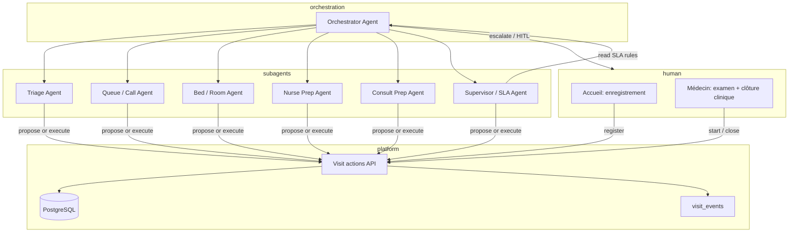

# PICU — État des lieux et feuille de route (agents IA)

Document de synthèse : ce qui est réalisé dans le dépôt actuel, les écarts par rapport à la vision produit, et un plan d’évolution vers un **orchestrateur + sous-agents** (entrée accueil → enchaînement automatisé jusqu’à la fin de la prise en charge médicale).

---

## 1. Vision cible (futur)

**Entrée humaine minimale :** l’accueil enregistre un nouveau patient.

**Ensuite :** un agent orchestrateur et des sous-agents coordonnent le flux (triage, appel, placement lit, préparation infirmière, préparation consultation) jusqu’à ce que le **médecin** mène l’examen et **clôture** la visite.

Les étapes cliniques finales (`start` / `close` consultation) restent sous responsabilité médicale, avec gouvernance progressive (suggestion → validation → automatisation limitée).

---

## 2. Ce qui est réalisé aujourd’hui (code actuel)

> **Note :** `context.md` décrit encore une architecture antérieure ou cible (Socket.IO, table `queue`, `aiTriageService`, auto-routing à l’appel). Le **code en place** est plus proche de `PLAN.md` + tableaux de bord par rôle.

### 2.1 Socle technique (solide)

| Domaine | Statut | Détail |
|--------|--------|--------|
| Machine à états visite | ✅ | `waiting` → `placed` → `in_treatment` → terminaux (`discharged`, `transferred`, `left_without_seen`). |
| Actions transactionnelles | ✅ | `visitService` : register, call, place, return, start, close, triage (priorité), remplissage consultation. |
| Source de vérité | ✅ | `visits.status`, affectations lits, consultations ; règles d’intégrité (une visite active/patient, un lit/visite, etc.). |
| Piste d’audit | ✅ | `visit_events` à chaque transition — base idéale pour agents et conformité. |
| Auth & permissions | ✅ | JWT, capacités par rôle (`backend/src/config/roles.js`), contrôle côté API. |
| Modèle données | ✅ | Zones → salles → lits ; patients ; utilisateurs ; équipes de salle (`room_teams`, infirmiers liés à une salle + médecin). |
| API | ✅ | `/board`, `/visits/*`, `/chief/*`, `/clinician/workspace`, `/users`, `/beds`. |

### 2.2 Parcours métier (UI)

| Rôle | Réalisé |
|------|---------|
| **Accueil** | Enregistrement, file d’attente (filtres, KPI), capacités `register` + `call`. |
| **Infirmier** | Ma salle, file, plan des lits (affectation lits libres), triage priorité, place/return, peut **remplir** la consultation et clôturer pour le médecin de salle. |
| **Médecin** | Charge de travail, salle, plan des lits (lecture + ouverture patients de sa salle), file en lecture seule, start/close consultation. |
| **Chef** | Pipeline, alertes SLA / blocages, équipes par salle, plan des lits, tableaux actifs/clôturés, enregistrement avec override. |
| **Admin** | Utilisateurs, rôles, flux mot de passe temporaire. |

### 2.3 UX et exploitation récentes

- Shell dashboard partagé, thèmes par rôle, barres KPI.
- **Plan des lits** (`BedPlanPanel`) : zones, salles, filtres, occupation — infirmier / médecin / chef.
- Rafraîchissement **SSE** sur `visit_events` + **polling ~30 s** en secours.
- **`/board`** : hub santé backend + lien vers le dashboard du rôle, pas le board opérationnel unique décrit dans `PLAN.md`.
- **Hygiène dépôt** : `.gitignore` racine, `.env` hors git, hooks pre-commit, workflow CI « secret guard ».

### 2.4 Écarts vs vision produit (`context.md` / IA)

| Vision | Aujourd’hui |
|--------|-------------|
| Triage IA (LLM + fallback) | ❌ Absent du backend ; ajustement priorité infirmier via API. |
| Temps réel (Socket.IO) | ⚠️ SSE `GET /api/events/stream` + polling secours 30 s (pas Socket.IO). |
| Auto-orientation à l’appel | ❌ `call` reste en `waiting`, met à jour `last_called_at` / `call_count`. |
| Un seul board pour tous | ❌ Dashboards par rôle + vue chef. |
| Orchestration agents | ❌ Non démarrée — hooks prêts : **événements + capacités + transactions**. |

**En une phrase :** moteur de workflow urgences **transactionnel**, UIs **par rôle**, **supervision chef (SLA)** ; il manque la couche **automation / IA / temps réel**.

---

## 3. Écart par rapport à la vision « agents »

Aujourd’hui, après l’enregistrement, **chaque étape** suppose un **humain** avec la bonne capacité.

Pour les agents il faut :

1. **État observable** — déjà en place (`visits`, `visit_events`, snapshots board).
2. **Actions sûres** — les agents doivent appeler les **mêmes APIs** que l’UI, pas du SQL direct.
3. **Politique** — auto vs suggestion (surtout clinique).
4. **Orchestration** — agent « chef de salle » + sous-agents spécialisés.
5. **Temps réel + file de tâches** — plancher commun humains / agents.

---

## 4. Architecture agents recommandée

Couches (ne pas remplacer l’app, l’orchestrer) :

### 4.1 Sous-agents ↔ capacités existantes

| Sous-agent | Rôle | Capacités API actuelles | Autonomie suggérée |
|------------|------|-------------------------|-------------------|
| **Intake** | Normaliser l’enregistrement, dédoublonner | `register` | Auto après saisie accueil |
| **Triage** | Proposer P1–P5 + justification | `triage` (PATCH priorité) | **Suggérer** → validation infirmier |
| **Queue** | Appeler selon flux / attente | `call` | Auto avec règles (priorité, SLA) |
| **Bed** | Choisir lit + placer | `place` | Auto si lit libre compatible |
| **Room** | Aligner équipe salle | lecture teams / staff | Recommandation d’abord |
| **Nurse prep** | Pré-remplir consultation | `fill` | **Suggestion** uniquement |
| **Consult prep** | Synthèse timeline pour médecin | lecture visite + events | Notifications |
| **Supervisor** | Blocages SLA, rééquilibrage | logique `chiefSla.js` | Escalade chef / orchestrateur |

L’**orchestrateur** porte l’objectif par visite : *enregistré → appelé → au lit → en prise en charge → clôturé*, réagit aux **événements**, appelle les **outils**, applique les **politiques**, journalise les décisions (futur : tables `agent_runs` / `agent_actions`).

### 4.2 Human-in-the-loop (phases initiales)

- **Accueil :** enregistrement toujours humain (entrée déclarée).
- **Médecin :** `start` et `close` humains jusqu’à cadre clinique clair.
- **Infirmier :** validation triage et placement en phase 2 ; automatisation étroite en phase 3.

---

## 5. Plan d’amélioration par phases

### Phase A — Stabiliser le plancher humain (0–3 mois)

*Objectif : floor fiable avant autonomie.*

1. Aligner la documentation (`context.md` ↔ schéma Neon + routes réelles).
2. **Temps réel** — SSE ou WebSocket sur `visit_events` (ou version board).
3. Clarifier **`/board`** vs dashboards par rôle (un modèle mental produit).
4. Parcours accueil → appel → handoff infirmier explicite dans l’UI.
5. Observabilité — logs structurés par action visite ; métriques SLA.
6. **API prête agents** — ✅ idempotence (`Idempotency-Key`), `actor_type` / `agent_run_id` sur `visit_events`, wrappers `visitTools`.

### Phase B — Assistance IA (3–6 mois)

*Objectif : suggestions sur les mêmes rails.*

1. Triage async à l’enregistrement → table `ai_triage` + file de jobs.
2. UI : suggestion visible accueil/infirmier ; acceptation = event `triage_validated`.
3. Suggestion de lit (règles puis ML).
4. Copilot chef (lecture seule d’abord) sur blocages + plan des lits.

### Phase C — Multi-agents supervisés (6–12 mois)

*Objectif : orchestrateur avec approbations.*

1. Couche **tools** — une tool par action visite (schéma + audit).
2. Service **orchestrateur** — machine à états par visite, abonnement events.
3. **Moteur de politique** — règles configurables (ex. auto-`call` P1–P2 si attente > X).
4. UI **boîte de proposals** — approuver / rejeter / modifier avant exécution.
5. **Mode simulation** — plan sans écriture, comparaison aux actions humaines.

### Phase D — Vision cible (12+ mois)

*Objectif : entrée accueil ; médecin clôt le clinique.*

1. Pipeline auto pour étapes non cliniques : call → place → prep → notifier médecin.
2. Rééquilibrage charge — agent superviseur + SLA.
3. Sous-agents par zone / shift.
4. Conformité — export audit, versioning agents, kill switch par visite.

---

## 6. Principes de conception

1. Les agents **ne contournent pas** `visitService` — mêmes transactions, mêmes 403.
2. **`visit_events`** = système nerveux ; l’orchestrateur réagit aux events, pas au polling UI.
3. **Suggérer avant automatiser** — triage et choix de lit.
4. **Frontière médecin** — `start` / `close` = clôture clinique ; agents préparent en amont.
5. **SLA chef** (`chiefSla.js`) = garde-fous pour le sous-agent Superviseur.

---

## 7. Priorités immédiates (au choix)

| Objectif | Première action |
|----------|-----------------|
| Fondation agents | Flux events + `actor_type` + wrappers tools sur actions visite |
| Ops du jour | Board temps réel + clarté accueil → infirmier |
| Valeur IA rapide | Triage suggéré async à l’enregistrement |
| Clarté équipe | Mettre à jour `context.md`, retirer concepts legacy non implémentés |

---

## 8. Références dans le dépôt

| Fichier | Contenu |
|---------|---------|
| `PLAN.md` | Machine à états, permissions, schéma cible |
| `context.md` | Vision produit (partiellement legacy) |
| `backend/src/services/visitService.js` | Actions workflow |
| `backend/src/config/roles.js` | Capacités par rôle |
| `backend/src/config/chiefSla.js` | SLA et blocages |
| `backend/migrations/20261007_room_teams.sql` | Équipes de salle |
| `frontend/src/components/beds/BedPlanPanel.jsx` | Plan des lits |

---

*Dernière mise à jour : octobre 2026 — à réviser après chaque jalon majeur (temps réel, triage IA, premier orchestrateur).*
