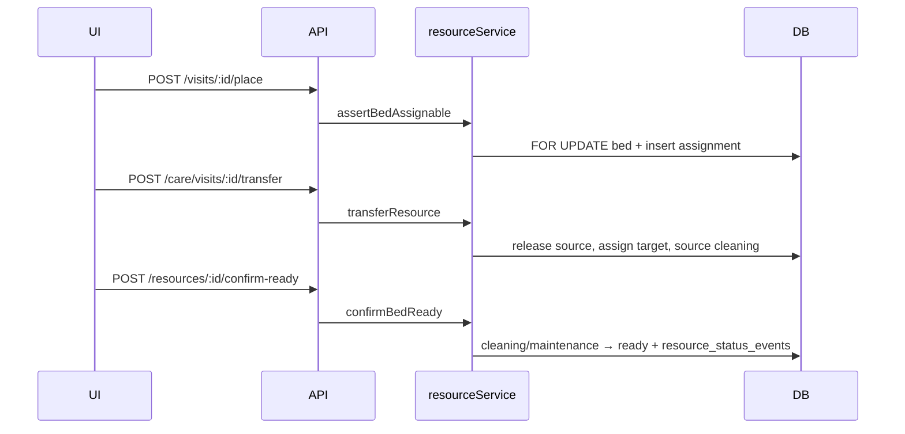

# Architecture — Smart Resource Management V4

## Invariants

1. **Occupation** = `bed_assignments.released_at IS NULL` (jamais éditée manuellement).
2. **Disponible à l'affectation** = actif + `operational_status = 'ready'` + non occupé.
3. **Turnover** = libération → `cleaning` ; `ready` uniquement via `confirmBedReady`.
4. **Mutations** = transaction + `FOR UPDATE` sur lit et affectations.

## Flux principaux

## API (montage `/api/resources`)

| Route | Rôle |
|-------|------|
| `GET /board` | Arbre zones/salles + métriques |
| `GET /capacity` | Capacité agrégée + attente lit |
| `GET /eligible?visitId=` | Suggestions déterministes |
| `GET /:id`, `GET /:id/history` | Détail et audit |
| `POST /:id/confirm-ready`, `/mark-cleaning`, `/operational-status` | Turnover / indisponibilité |

Compatibilité : `/api/care/resources/*` et `/api/workflow/resources/board` conservés.

## SSE

Les changements opérationnels publient un événement bus (`resource_status_changed`) avec l’id de `resource_status_events` ; les clients rafraîchissent via le hook SSE existant.
