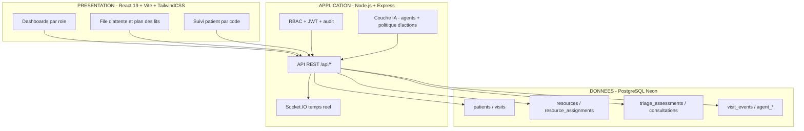

# Prompts pour générer les diagrammes du rapport

> Utilisez ces prompts avec un outil de génération de diagrammes (Mermaid Live, PlantUML, Draw.io, ou un LLM) puis **exportez en PNG** dans `rapport-stage/images/` avec le nom exact indiqué.
>
> Format attendu : haute résolution, texte lisible, palette professionnelle médicale (bleu/cyan hospitalier), fond blanc.

---

## 1. Diagramme de cas d'utilisation → `use_case_diagram.png`

**Prompt Mermaid** :

```
%%{init: {'theme':'base','themeVariables':{'primaryColor':'#e8f0fe','primaryBorderColor':'#1a73e8','primaryTextColor':'#202124','lineColor':'#5f6368'}}}%%
flowchart LR
    subgraph SYS[PICU - Plateforme de Coordination des Urgences]
        UC1[UC1 S'authentifier]
        UC2[UC2 Enregistrer patient et visite]
        UC3[UC3 Appeler un patient]
        UC4[UC4 Trier / reprioriser]
        UC5[UC5 Triage assisté par IA]
        UC6[UC6 Affecter une ressource]
        UC7[UC7 Demarrer / cloturer consultation]
        UC8[UC8 Transferer / reaffecter]
        UC9[UC9 Demander examen / tache]
        UC10[UC10 Superviser le service]
        UC11[UC11 Administrer utilisateurs]
        UC12[UC12 Suivre sa visite par code]
    end

    Receptionniste((Receptionniste)) --> UC1
    Receptionniste --> UC2
    Receptionniste --> UC3
    Infirmier((Infirmier)) --> UC1
    Infirmier --> UC4
    Infirmier --> UC6
    Infirmier --> UC9
    Medecin((Medecin)) --> UC1
    Medecin --> UC7
    Medecin --> UC8
    Medecin --> UC9
    Chef((Chef de service)) --> UC1
    Chef --> UC10
    Admin((Administrateur)) --> UC1
    Admin --> UC11
    Patient((Patient)) --> UC12
    IA((Systeme IA)) --> UC5
    UC4 -.include.-> UC5
```

**Prompt texte** :
> « Générez un diagramme de cas d'utilisation UML professionnel pour une plateforme hospitalière d'urgences nommée "PICU". Acteurs : Réceptionniste, Infirmier, Médecin, Chef de service, Administrateur, Patient, Système IA. Cas : s'authentifier, enregistrer patient et visite, appeler un patient, trier/reprioriser, triage assisté par IA (inclus dans le triage), affecter une ressource, démarrer/clôturer consultation, transférer/réaffecter, demander examen/tâche, superviser le service, administrer utilisateurs, suivre sa visite par code. Style : fond blanc, bleu médical, texte lisible, layout horizontal. Nom : use_case_diagram.png. »

---

## 2. Diagramme de séquence → `sequence_diagram.png`

Flux : enregistrement d'un patient (Réceptionniste → Frontend → API → PostgreSQL, + IA en mode shadow en arrière-plan).

**Prompt Mermaid** :

```
sequenceDiagram
    participant R as Receptionniste
    participant F as Frontend React
    participant A as API Express
    participant IA as Agent IA (shadow)
    participant DB as PostgreSQL

    R->>F: Saisit identite + motif + mode d'arrivee
    F->>A: POST /api/visits/register (cle d'idempotence)
    A->>DB: Recherche patient (numero national)
    A->>DB: INSERT patients si inconnu
    A->>DB: Verifie absence de visite active
    A->>DB: INSERT visits (status=waiting, code public, code public / phase=registered)
    A->>DB: INSERT visit_events (register)
    par Triage IA en arriere-plan
        A->>IA: recommandation de triage
        IA->>DB: INSERT agent_runs + agent_recommendations
    end
    A-->>F: 201 {visit_id, code, position}
    F-->>R: Confirmation + code de suivi
```

**Prompt texte** :
> « Générez un diagramme de séquence UML en français pour l'enregistrement d'un patient dans PICU. Objets : Réceptionniste, Frontend React, API Express, Agent IA (shadow), PostgreSQL. Étapes : saisie identité/motif/mode d'arrivée ; POST /api/visits/register avec clé d'idempotence ; recherche patient par numéro national ; insertion patient si inconnu ; vérification d'absence de visite active ; insertion de la visite (statut waiting, code public, phase registered) ; insertion d'un événement visit_events ; en parallèle, l'agent IA insère une exécution et une recommandation ; réponse 201 avec identifiant, code et position. Style : fond blanc, bleu médical, haute résolution. Nom : sequence_diagram.png. »

---

## 3. Diagramme d'activité → `activity_diagram.png`

Machine à états de la visite.

**Prompt Mermaid** :

```
stateDiagram-v2
    [*] --> Enregistre : Arrivee patient (register)
    Enregistre --> EnAttente : status=waiting
    EnAttente --> EnAttente : Appel (called_at, sans sortie de file)
    EnAttente --> Place : Affectation ressource (place)
    Place --> EnAttente : Retour en file (return)
    Place --> EnTraitement : Demarrage consultation (start)
    EnTraitement --> EnTraitement : Triage / reevaluation
    EnTraitement --> EnTraitement : Transfert de lit (reste in_treatment)
    EnTraitement --> Sortie : Cloture (close, outcome)
    EnTraitement --> Reaffecte : Transfert vers autre salle
    Reaffecte --> EnAttente : Statut waiting, retour en file
    Sortie --> [*] : discharged / transferred / left_without_seen
```

**Prompt texte** :
> « Générez un diagramme d'activité UML en français de la machine à états d'une visite aux urgences (PICU). États : enregistré, en attente (waiting), placé (placed), en traitement (in_treatment), puis sortie ou réaffectation. Transitions : arrivée → register → waiting ; appel (reste en file) ; affectation d'une ressource → placed ; retour en file → waiting ; démarrage consultation → in_treatment ; triage/réévaluation et transfert de lit (reste in_treatment) ; clôture → discharged/transferred/left_without_seen ; transfert vers autre salle → réaffecté → waiting (retour en file). Style : fond blanc, bleu médical, haute résolution. Nom : activity_diagram.png. »

---

## 4. Diagramme de classes → `class_diagram.png`

**Prompt Mermaid** (d'après le schéma réel) :

```
classDiagram
    class users {
        -id : serial
        -full_name : string
        -username : string
        -password_hash : string
        -role : string
        -is_active : boolean
    }
    class patients {
        -id : serial
        -full_name : string
        -national_id : string
        -phone : string
        -birth_date : date
        -gender : string
    }
    class visits {
        -id : serial
        -patient_id : FK
        -code : string
        -status : string
        -care_stage : string
        -priority : int
        -zone_id : FK
        -called_at : timestamp
        -arrived_at : timestamp
    }
    class triage_assessments {
        -id : serial
        -visit_id : FK
        -priority : int
        -kind : string
        -critical_flag : boolean
        -vitals : jsonb
    }
    class resources {
        -id : serial
        -resource_type : string
        -label : string
        -status : string
        -operational_status : string
        -parent_resource_id : FK
    }
    class resource_assignments {
        -id : serial
        -visit_id : FK
        -resource_id : FK
        -active : boolean
    }
    class consultations {
        -id : serial
        -visit_id : FK
        -doctor_id : FK
        -started_at : timestamp
        -ended_at : timestamp
        -outcome : string
    }
    class visit_events {
        -id : serial
        -visit_id : FK
        -event_type : string
        -from_status : string
        -to_status : string
        -actor_id : FK
        -created_at : timestamp
    }
    class transfer_requests {
        -id : serial
        -visit_id : FK
        -from_resource_id : FK
        -to_resource_id : FK
        -status : string
    }
    class agent_recommendations {
        -id : serial
        -run_id : FK
        -risk_level : string
        -requires_approval : boolean
        -payload : jsonb
    }

    patients "1" --> "0..*" visits : effectue
    visits "1" --> "0..*" triage_assessments : evalue
    visits "1" --> "0..1" resource_assignments : affecte
    resources "1" --> "0..*" resource_assignments : occupe
    visits "1" --> "0..*" consultations : donne lieu
    visits "1" --> "0..*" visit_events : journalise
    visits "1" --> "0..*" transfer_requests : fait l'objet
    resources "*" --> "0..1" resources : parent/enfant
    users "1" --> "0..*" consultations : realise
    users "1" --> "0..*" visit_events : provoque
    agent_recommendations "*" --> "1" visits : propose
```

**Prompt texte** :
> « Générez un diagramme de classes UML en français pour PICU. Classes : users, patients, visits (code, status, care_stage, priority, called_at), triage_assessments (priority, kind, critical_flag, vitals jsonb), resources (resource_type, operational_status, parent_resource_id), resource_assignments (active), consultations (doctor_id, outcome), visit_events (event_type, from_status, to_status, actor_id), transfer_requests (status), agent_recommendations (risk_level, requires_approval, payload). Associations : Patient 1–N Visite ; Visite 1–N triage_assessments ; Visite 1–1 affectation active ; Ressource 1–N affectations ; Visite 1–N consultations ; Visite 1–N visit_events ; Visite 1–N transfer_requests ; Ressource parent-enfant ; User 1–N consultations et visit_events ; recommandation liée à une visite. Multiplicités visibles. Style : fond blanc, bleu médical, haute résolution. Nom : class_diagram.png. »

---

## 5. Diagramme d'architecture → `architecture_picu.png`

**Prompt Mermaid** (architecture 3 couches) :



**Prompt texte** :
> « Générez un diagramme d'architecture en trois couches pour PICU. Couche Présentation : React 19 + Vite + TailwindCSS (dashboards par rôle, file d'attente et plan des lits, suivi patient par code). Couche Application : Node.js + Express (API REST /api/*, Socket.IO temps réel, couche IA avec agents et politique d'actions, RBAC + JWT + audit). Couche Données : PostgreSQL Neon (patients/visits, resources/affectations, triage/consultations, visit_events/agent_*). Flèches entre couches. Style : fond blanc, bleu médical, haute résolution. Nom : architecture_picu.png. »

---

## Bonnes pratiques d'export

1. **Mermaid Live** : collez le bloc ```mermaid```, puis *Export as PNG* (échelle 3x pour la qualité).
2. **PlantUML / Draw.io** : transformez le prompt texte en diagramme, puis export PNG haute résolution.
3. **Largeur/qualité** : PNG ≥ 1200 px de large pour un rendu net dans le PDF.
4. **Nom exact** : respectez le nom de fichier indiqué, sans espaces ni accents, déposé dans `rapport-stage/images/`.
5. Après dépôt, le rapport intègre automatiquement l'image (mécanisme `\IfFileExists`). Voir `images/IMAGES_A_UPLOADER.md`.
